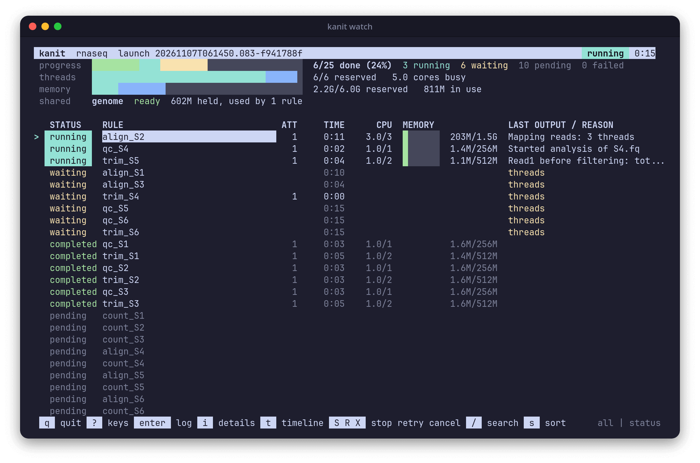

# workz

workz runs a prepared graph of file-producing rules on one Linux workstation. It starts every rule whose inputs are ready as long as the machine's CPU and memory budget allows, enforces each rule's memory and CPU request with its own cgroup, reuses work only when nothing it depends on has changed, and keeps a complete record of every attempt.



- **Explicit graphs.** A TOML file lists rules with their inputs, outputs, command and request, and `workz graph` shows it in layers: rules, files, shared inputs and resource groups.
- **Steps written once.** A pipeline template describes each step once over a sample sheet; `workz prepare` writes the explicit workflow, one labelled rule per sample, and `--check` shows what an edit changes.
- **Fits the machine.** Ready rules start in critical-path order while the thread, memory and job budget allows, with resource groups for limits such as disk bandwidth; `workz plan --budget` checks every request before a launch.
- **Enforced requests.** Each attempt runs in its own cgroup inside a systemd scope, with no network; a rule that exceeds its memory is stopped, not the machine.
- **Exact reuse.** A rule runs again only when its command, environment, request, declared outputs, inputs, producers or the engine key changed, or when you ask, and a changed output is never silently overwritten.
- **Shared indexes.** A large index is loaded once and counted once in memory, as mapped files or as a container service such as a STAR genome in shared memory.
- **Containers.** Rules can run in local images through rootless Podman, inside the same limits and records.
- **Answers, not logs.** A live terminal view, per-attempt reports, the critical path, waiting by reason, time per step, sample, category and tool, request suggestions, launch comparisons and a self-contained HTML report.
- **Citable results.** `workz report --methods` names the workflow, engine, each tool with its version and image, and each step's request and command behind the results in a working directory.

## Requirements

Linux on x86-64 with cgroup v2 and a systemd user manager. Container rules and shared services also need rootless Podman. Building needs Zig 0.16.0, which downloads the one library workz uses; [Installation](wiki/Installation.md) has the details.

## Quick start

```sh
zig build -Doptimize=ReleaseSafe
export PATH="$PWD/zig-out/bin:$PATH"

mkdir demo && cd demo
workz init                                                # writes a commented workflow.toml
mkdir data && seq 1000 > data/S1.txt
workz plan workflow.toml                                  # what would run, and why
workz run workflow.toml --max-threads 2 --max-memory 1G   # run it on 2 threads and 1 GiB
cat out/report.txt                                        # lines: 1000
workz report --bottlenecks                                # what limited the run
```

For one rule per sample, `workz init --template` writes a pipeline template and sample sheet instead, and `workz prepare` writes the workflow from them ([Writing workflows](wiki/Writing-Workflows.md#prepare-from-a-template)).

Then follow [Getting started](wiki/Getting-Started.md), which writes, runs and changes a small workflow step by step.

## Documentation

The [user guide](wiki/Home.md) covers writing workflows, scheduling, reuse, containers, running, watching and reports, with a [workflow reference](wiki/Workflow-Reference.md), a [command reference](wiki/Command-Reference.md) and [troubleshooting](wiki/Troubleshooting.md). The [small report tour](examples/report-tour/README.md) demonstrates preparation, reports, reuse and failure recovery with three rules and no downloads. [examples/](examples/) also holds a preparer for a real fusion-calling run. [CHANGELOG.md](CHANGELOG.md) lists the changes in every version.

## Status

The latest release is workz 0.6.0. Before 1.0, a minor version may change the workflow format, the records under `.workz/` and the command line; the changelog says at the top of each version what such a change needs from you.

## License

Apache-2.0, see [LICENSE](LICENSE). Third-party notices are in [THIRD_PARTY.md](THIRD_PARTY.md).
