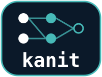
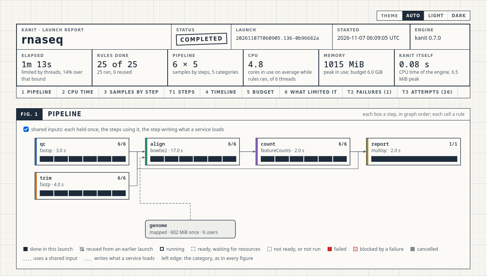

<!-- markdownlint-disable MD033 MD041 -->

<div align="center">
  
  <p><em><strong>K</strong>ahn's <strong>A</strong>lgorithm for <strong>N</strong>etworks of <strong>I</strong>nterdependent <strong>T</strong>asks</em></p>
  <p><strong>A workflow engine for one Linux workstation: every task within budget, every attempt on record.</strong></p>
  <p>
    <a href="CHANGELOG.md"></a>
    <a href="https://ziglang.org/download/"></a>
    <a href="https://github.com/zenteomics/kanit/wiki/Installation"></a>
    <a href="#status"></a>
    <a href="LICENSE"></a>
  </p>
  <p>
    <a href="https://github.com/zenteomics/kanit/wiki/Home"></a>
    <a href="https://github.com/zenteomics/kanit/wiki/Workflow-Reference"></a>
    <a href="https://github.com/zenteomics/kanit/wiki/Command-Reference"></a>
    <a href="https://zenteomics.com"></a>
  </p>
</div>

---

A bioinformatics pipeline is hundreds or thousands of steps, one per sample, competing for the same cores and memory. kanit runs it as an explicit graph of rules: it starts each rule as soon as its inputs are ready and its request fits the budget, holds it to that request, reruns only what changed, and keeps the command, logs and measured resources of every attempt. *Kanıt* is Turkish for evidence.

<picture>
  <source media="(prefers-color-scheme: dark)" srcset="wiki/images/report-pipeline-dark.png">
  
</picture>

## What it does

- **Holds every rule to its request.** Each attempt runs in its own cgroup with its CPU and memory limit and no network; a rule that overruns its memory is stopped, not the machine.
- **Loads a large index once.** A reference index is mapped once, or held in shared memory by a Podman service such as a STAR genome, and counted once against the budget.
- **Keeps the last good result.** A rule reruns only when its command, environment, request, inputs or producers changed, and a failed rerun puts the earlier outputs back.
- **Says why a launch was slow.** `report --bottlenecks` names what limited it, and `report --suggest` sizes each step's request from what it used.
- **Writes the methods section.** `report --methods` lists the workflow, each tool with its version and image, and each step's command.
- **Fits the machine.** Ready rules start by priority and critical path within the thread, memory and job budget, and a large rule that cannot start never holds back smaller ones.

It is one executable, with no daemon and no database: everything it knows is in `.workz/` beside the workflow.

<details>
<summary>The live terminal view</summary>


</details>

## A workflow

A workflow is a TOML file of rules. Each rule names the files it reads and writes, one shell command and its request:

```toml
[[rules]]
name = "S1__count"
input = ["data/S1.txt"]
output = ["out/S1.count"]
shell = "wc -l < data/S1.txt > out/S1.count"
threads = 1
memory = "256M"
```

Rules connect through their files: a rule that reads `out/S1.count` runs after this one. For one rule per sample, `kanit prepare` writes the file from a pipeline template and a sample sheet, so the graph that runs is the file you review.

## Quick start

kanit needs Linux on x86-64 with cgroup v2, a systemd user manager and unprivileged user namespaces; [Installation](https://github.com/zenteomics/kanit/wiki/Installation) checks each one. Building needs Zig 0.16.0.

```sh
zig build -Doptimize=ReleaseSafe
export PATH="$PWD/zig-out/bin:$PATH"

mkdir demo && cd demo
kanit init                                                # writes a commented workflow.toml
mkdir data && seq 1000 > data/S1.txt
kanit plan workflow.toml                                  # what would run, and why
kanit run workflow.toml --max-threads 2 --max-memory 1G   # run it on 2 threads and 1 GiB
cat out/report.txt                                        # lines: 1000
kanit report --bottlenecks                                # what limited the run
```

`run` opens with the launch's shape and a table of its steps, tools and versions, then logs a row for each rule, by its step and sample, as it starts and ends. The launch keeps the same text in `.workz/latest/launch.log`:

```text
kanit 0.7.0   example   launch 20261108T121723.759-3460c6e8
          plan         2 rules: 2 steps for 1 sample
          budget       2 threads, 1.0 GiB, 2 jobs, isolated
          records      .workz/latest/   log launch.log   page report.html

          TOOL  VERSION  STEP    RULES
          wc    9.10     count       1
          -     -        report      1

TIME      RULES  STATUS  TOOL  STEP    SAMPLE     TOOK             MEMORY      CPU  NOTE
05:17:24    0/2  START   wc    count   S1                     - / 256 MiB    - / 1
05:17:24    1/2  DONE    wc    count   S1         3 ms        - / 256 MiB    - / 1
05:17:24    1/2  START         report                         - /  64 MiB    - / 1
05:17:24    2/2  DONE          report             3 ms        - /  64 MiB    - / 1
```

On a terminal the `START` rows give way to a footer of each step's progress and the running rules.

Run `kanit plan workflow.toml` again and both rules are reused, since nothing they depend on changed. [Getting started](https://github.com/zenteomics/kanit/wiki/Getting-Started) goes further step by step, the [report tour](examples/report-tour/README.md) shows a failed rerun keeping the last good output, and [Heyer 2019 fusion calls](examples/heyer2019-fdz/README.md) prepares a real pipeline over four samples.

> [!WARNING]
> Rule commands are trusted local code. Isolation enforces requests and cuts the network; it is not a sandbox for hostile commands.

## When to use something else

kanit runs one prepared graph on one Linux workstation. Another engine fits better when:

- The work spans several machines, an HPC scheduler or a cloud. Nextflow and Snakemake run there; kanit does not.
- The graph must grow while it runs, from results unknown before the launch. kanit runs only the graph it was given.
- Tools should be installed on demand from conda or a registry. kanit uses installed tools and local Podman images, and never pulls one.

## Documentation

The [user guide](https://github.com/zenteomics/kanit/wiki/Home) follows a workflow from the first file to the last report:

[Installation](https://github.com/zenteomics/kanit/wiki/Installation) | [Getting started](https://github.com/zenteomics/kanit/wiki/Getting-Started) | [Concepts](https://github.com/zenteomics/kanit/wiki/Concepts) | [Writing workflows](https://github.com/zenteomics/kanit/wiki/Writing-Workflows) | [Resources and scheduling](https://github.com/zenteomics/kanit/wiki/Resources-and-Scheduling) | [Reuse and resume](https://github.com/zenteomics/kanit/wiki/Reuse-and-Resume) | [Containers and services](https://github.com/zenteomics/kanit/wiki/Containers-and-Services)

[Running workflows](https://github.com/zenteomics/kanit/wiki/Running-Workflows) | [Watching a launch](https://github.com/zenteomics/kanit/wiki/Watching-a-Launch) | [Reports](https://github.com/zenteomics/kanit/wiki/Reports) | [Workflow reference](https://github.com/zenteomics/kanit/wiki/Workflow-Reference) | [Command reference](https://github.com/zenteomics/kanit/wiki/Command-Reference) | [Records](https://github.com/zenteomics/kanit/wiki/Records) | [Troubleshooting](https://github.com/zenteomics/kanit/wiki/Troubleshooting)

## Status

kanit is in development, and its current version is 0.7.0. Before 1.0, a minor version may change the workflow format, the records under `.workz/` and the command line; the [changelog](CHANGELOG.md) says first what each change needs from you. Versions up to 0.6.0 were released as workz, whose names remain in `.workz/`, the `WORKZ_` variables and the Zig module `workz`.

## License

Apache-2.0. See [LICENSE](LICENSE); third-party notices are in [THIRD_PARTY.md](THIRD_PARTY.md).

---

<p align="center"><em>
Roots before the leaves,<br>
each task waits until it fits;<br>
the records remain.
</em></p>
