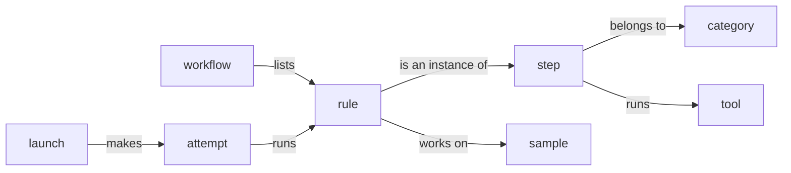
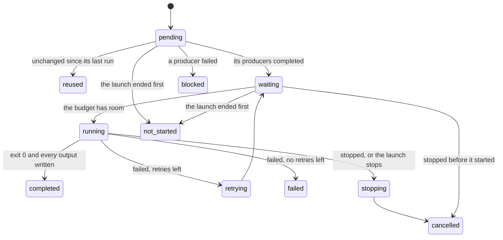

The rest of this guide uses a small set of terms: workflows and rules, the steps and samples that rules stand for, launches and attempts, budgets and requests, rule keys and records. This page defines each once.

## Workflow and working directory

A **workflow** is a TOML file that lists rules. Its directory is the **working directory**, unless a command is given `-d DIR`. Relative paths in the workflow resolve against the working directory, a rule's command starts there unless the rule sets a `workdir`, and workz keeps its records in `.workz/` inside it.

workz reads the graph as written. Samples, parameters and file names are expanded by whatever prepares the file, usually a short script ([Writing workflows](Writing-Workflows.md#generate-the-file)).

## Rules and the graph

A **rule** has a name, a list of **input** files, a list of **output** files, one **shell** command and a **request** for threads and memory. Rule B depends on rule A when one of B's inputs is one of A's outputs; this is the only way rules are connected. An input that no rule produces is an **external input**, a file that must exist before the rule runs.

A rule's outputs must be files inside the working directory. Inputs may be anywhere, including a reference directory elsewhere on the machine. A directory can be an input; its identity then covers every file below it, so a change to any of them counts as a change to the input.

## Steps, samples, categories and tools

A workflow runs a few commands on many pieces of data, one rule for each pair. Four labels on a rule say which pair it is:

- A **step** is what the rule does in the pipeline, such as `STAR_ALIGN` or `trim`. Rules that run one command on different data are instances of one step, and the step is what reports size and compare: six alignments make one row.
- A **sample** is the data the rule works on, such as `ctrl1`. A rule that combines every sample, such as a count matrix or a MultiQC report, has none.
- A **category** groups steps by purpose, such as `qc`, `alignment` or `quantification`.
- A **tool** is the program the step runs, such as `STAR 2.7.11b`.

Part of an RNA-seq workflow, labelled:

| Rule          | Step            | Sample   | Category       | Tool          |
| ------------- | --------------- | -------- | -------------- | ------------- |
| `fastp_ctrl1` | `FASTP`         | `ctrl1`  | trimming       | fastp 1.4.0   |
| `star_ctrl1`  | `STAR_ALIGN`    | `ctrl1`  | alignment      | STAR 2.7.11b  |
| `star_treat1` | `STAR_ALIGN`    | `treat1` | alignment      | STAR 2.7.11b  |
| `sort_ctrl1`  | `SAMTOOLS_SORT` | `ctrl1`  | alignment      | samtools 1.24 |
| `counts`      | `COUNT_MATRIX`  |          | quantification | gawk          |
| `multiqc`     | `MULTIQC`       |          | report         | MultiQC 1.35  |

A rule declares its labels with the keys `step`, `sample`, `category` and `tool` ([Workflow reference](Workflow-Reference.md#rules)). A label it does not declare is taken from its name and image:

- The step is the text after the last `__` (`ctrl1__STAR_ALIGN` is `STAR_ALIGN`), else the text before the last `_` (`align_ctrl1` is `align`), else the whole name.
- The sample is the text before the last `__` (`ctrl1`). A name without `__` has none.
- The tool is the image's name without its registry and tag (`quay.io/biocontainers/star:2.7.11b--h5ca1c30_8` is `star`). A host rule has none.
- A rule has a category only when it declares one.

> [!TIP]
> A generator knows each rule's step and sample, so let it write them ([Writing workflows](Writing-Workflows.md#label-every-rule)). Names then stay free: without a declared step, `count_genes` is read as the step `count`.

Labels are not part of the [rule key](#rule-keys-and-reuse): adding or changing one reruns nothing. Each attempt records them, and they are used in three places:

- [Reports](Reports.md) size and compare steps, add up time per category and tool, and find the slow sample of each step.
- The [HTML report](Reports.md#the-html-report) colors attempts by category and draws a table of samples by steps.
- The scheduler estimates a rule that has never completed by the median wall time of its step ([Resources and scheduling](Resources-and-Scheduling.md#which-rule-starts-first)).

## Launches and attempts

A **launch** is one execution of `workz run`; this guide also calls it a run where that reads better, as in the run lock. Each launch gets an ID made of its UTC start time and a random suffix, such as `20261026T033653.780-bb9b10ee`, and a directory in `.workz/launches/`.

Within a launch, each rule that runs has one or more **attempts**, numbered from 1. A failed attempt is retried while the rule has retries left. Each attempt keeps its command, request, standard output and error, and a record of what it used, in `.workz/launches/<ID>/attempts/<rule>/<NNN>/`.

A rule moves through these states in a launch:

A **waiting** rule is ready to run but does not fit yet; workz records what it waited for, such as `threads`, `memory` or a resource group. A **stopping** rule has been sent `SIGTERM` and is given its grace period to end. A launch that stops after a failure, or is cancelled, leaves the rules it never started `not_started`. [Running workflows](Running-Workflows.md#failures) describes failures, retries and cancellation.

## Budget and requests

A launch has a **budget**: a number of threads (`--max-threads`, default every online CPU), an amount of memory (`--max-memory`, default three quarters of the machine's memory) and a number of jobs (`--jobs`, default the thread budget). Each rule's **request** reserves threads and memory from the budget while it runs, and a rule starts only when its request fits in what is free.

The request is also a limit. With isolation, the default, each attempt runs in its own cgroup: its threads become a CPU quota, and its memory becomes a hard limit. An attempt that needs more memory than it requested is killed as out of memory, all of its processes together. [Resources and scheduling](Resources-and-Scheduling.md) explains admission, limits and the order in which ready rules start.

A **resource group** is a named counter with a capacity, for limits the budget cannot express: at most two rules that read from the same disk, or one rule that holds a licence. A rule takes units of a group while it runs.

## Shared inputs and services

A **shared input** is a large read-only file, such as a genome index, that many rules read. workz loads it into memory once, before its first user starts, and counts its memory once against the budget, however many rules use it. A **shared service** is a container that holds such an index in shared memory for container rules that join it ([Containers and services](Containers-and-Services.md)).

## Rule keys and reuse

Each time a rule completes, workz records its **rule key**: a digest of its command, its keyed environment (`PATH`, `LANG`, `LC_ALL`, `TZ` and the names passed with `--pass-env`), its request, its declared outputs, the identities of its input files (or their content digests, where one is stored) and the keys of the rules that produce them (or, for producers with `cutoff = true`, the digests of their outputs), and the engine key ([the rule key](Reuse-and-Resume.md#the-rule-key) lists each part). A rule is **reused** in a later launch when its key is the same and its outputs are still the files it wrote. Anything else makes it run again, and its consumers follow.

A file's **identity** is its inode, size, and modification and change times, so workz notices an edited file without reading it. Some files are keyed on their content instead ([Reuse and resume](Reuse-and-Resume.md#content-digests)).

## Records

Everything workz knows about earlier launches is in `.workz/`: `state.json` holds the key and outputs of every completed rule, and each launch directory holds its event stream, summary and attempts. The commands that show a launch only read these files, so they work from any terminal while the launch runs and after it ends. [Records](Records.md) describes every file.

## Other terms

- **Engine**: the `workz run` process that drives a launch. It starts attempts, watches them and writes the records; the reports give its own CPU time and memory as its cost.
- **Scope**: the transient systemd user unit a launch runs in, which holds its cgroups and limits it to the budget ([Isolation](Running-Workflows.md#isolation)).
- **Cgroup**: a Linux control group. With isolation, each attempt runs in one, which enforces its request and counts what it used.
- **Holder**: the process that keeps a shared input's files in memory while rules still need them.
- **Podman**: the rootless container runtime that runs container rules and shared services ([Containers and services](Containers-and-Services.md)).
