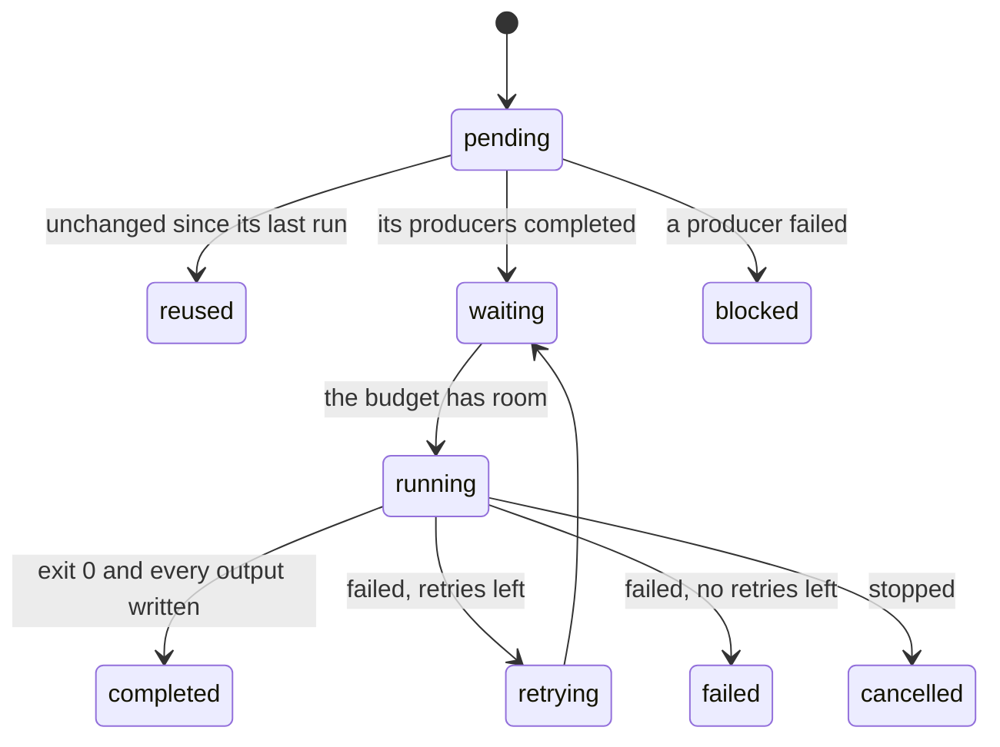

The rest of this guide uses a small set of terms: workflows and rules, launches and attempts, budgets and requests, rule keys and records. This page defines each once.

## Workflow and working directory

A **workflow** is a TOML file that lists rules. Its directory is the **working directory**, unless a command is given `-d DIR`. Relative paths in the workflow resolve against the working directory, a rule's command starts there unless the rule sets a `workdir`, and workz keeps its records in `.workz/` inside it.

workz reads the graph as written. Samples, parameters and file names are expanded by whatever prepares the file, usually a short script ([Writing workflows](Writing-Workflows.md#generate-the-file)).

## Rules and the graph

A **rule** has a name, a list of **input** files, a list of **output** files, one **shell** command and a **request** for threads and memory. Rule B depends on rule A when one of B's inputs is one of A's outputs; this is the only way rules are connected. An input that no rule produces is an **external input**, a file that must exist before the rule runs.

A rule's outputs must be files inside the working directory. Inputs may be anywhere, including a reference directory elsewhere on the machine. A directory can be an input; its identity then covers every file below it, so a change to any of them counts as a change to the input.

## Launches and attempts

A **launch** is one execution of `workz run`. Each launch gets an ID made of its UTC start time and a random suffix, such as `20261026T033653.780-bb9b10ee`, and a directory in `.workz/launches/`.

Within a launch, each rule that runs has one or more **attempts**, numbered from 1. A failed attempt is retried while the rule has retries left. Each attempt keeps its command, request, standard output and error, and a record of what it used, in `.workz/launches/<ID>/attempts/<rule>/<NNN>/`.

A rule moves through these states in a launch:

A **waiting** rule is ready to run but does not fit yet; workz records what it waited for, such as `threads`, `memory` or a resource group. [Running workflows](Running-Workflows.md#failures) describes failures, retries and cancellation.

## Budget and requests

A launch has a **budget**: a number of threads (`--max-threads`, default every online CPU), an amount of memory (`--max-memory`, default three quarters of the machine's memory) and a number of jobs (`--jobs`, default the thread budget). Each rule's **request** reserves threads and memory from the budget while it runs, and a rule starts only when its request fits in what is free.

The request is also a limit. With isolation, the default, each attempt runs in its own cgroup: its threads become a CPU quota, and its memory becomes a hard limit. An attempt that needs more memory than it requested is killed as out of memory, all of its processes together. [Resources and scheduling](Resources-and-Scheduling.md) explains admission, limits and the order in which ready rules start.

A **resource group** is a named counter with a capacity, for limits the budget cannot express: at most two rules that read from the same disk, or one rule that holds a licence. A rule takes units of a group while it runs.

## Shared inputs and services

A **shared input** is a large read-only file, such as a genome index, that many rules read. workz loads it into memory once, before its first user starts, and counts its memory once against the budget, however many rules use it. A **shared service** is a container that holds such an index in shared memory for container rules that join it ([Containers and services](Containers-and-Services.md)).

## Rule keys and reuse

Each time a rule completes, workz records its **rule key**: a digest of its command, its keyed environment (`PATH`, `LANG`, `LC_ALL`, `TZ` and the names passed with `--pass-env`), its request, its declared outputs, the identities of its input files (or their content digests, where one is stored) and the keys of the rules that produce them (or, for producers with `cutoff = true`, the digests of their outputs). A rule is **reused** in a later launch when its key is the same and its outputs are still the files it wrote. Anything else makes it run again, and its consumers follow.

A file's **identity** is its device, inode, size, and modification and change times, so workz notices an edited file without reading it. Some files are keyed on their content instead ([Reuse and resume](Reuse-and-Resume.md#content-digests)).

## Kinds of rules

Reports group attempts by **kind**: the rule name without its sample part. workz takes the text after the last `__` if the name has one (`S1__STAR_ALIGN` is `STAR_ALIGN`), otherwise the text before the last `_` (`align_S1` is `align`), otherwise the whole name. Naming rules `step_sample` or `sample__STEP` makes the per-kind sizing advice in [Reports](Reports.md) useful, and it lets the scheduler estimate a new rule's run time from others of its kind.

## Records

Everything workz knows about earlier launches is in `.workz/`: `state.json` holds the key and outputs of every completed rule, and each launch directory holds its event stream, summary and attempts. The commands that show a launch only read these files, so they work from any terminal while the launch runs and after it ends. [Records](Records.md) describes every file.
