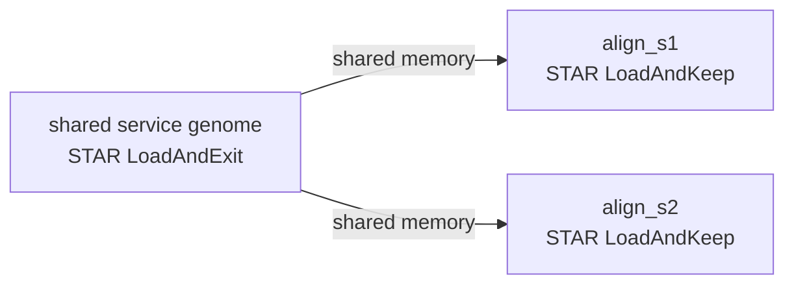

A rule can run its command inside a local container image through rootless Podman, and a shared service can hold a large index in memory once for many container rules. This page covers both, with a STAR alignment example that loads its genome once. You need rootless Podman and the images already pulled.

## Container rules

```toml
[[rules]]
name = "align_s1"
input = ["ref/star", "reads/s1.fq"]
output = ["aligned/s1.Aligned.out.sam"]
container = "quay.io/biocontainers/star:2.7.11b--h5ca1c30_8"
shell = """STAR --genomeDir ref/star --runThreadN $WORKZ_THREADS \
  --readFilesIn reads/s1.fq --outFileNamePrefix aligned/s1."""

[rules.resources]
threads = 2
memory = "2G"
```

`container = "IMAGE"` runs the rule's command with `/bin/sh` inside the image, with `set -eu` and `pipefail` where the shell supports it. Everything else about the rule stays the same: its inputs and outputs, its request, its place in the graph and its records.

> [!IMPORTANT]
> kanit never pulls images. Pull them with `podman pull` before the run; a missing image refuses the launch with `container image IMAGE is not available locally; kanit does not pull images`.

### Images and reuse

At the start of a launch, kanit resolves every image reference to its image ID and runs that ID. The ID is part of the rule key: retagging the same image reruns nothing, and a tag that now names a different image reruns the rules that use it.

### What the container sees

- **Files.** The working directory and the directory of every input outside it are mounted read-only at their own paths; the directory of every output, and the rule's `workdir`, read-write. An output directly in the working directory makes the whole working directory writable, except `.workz/`, which stays read-only so a command cannot change the records that decide reuse. The command starts in the `workdir`, or in the working directory, so relative paths work as in a host rule.
- **Isolation.** No network, no capabilities, no new privileges, and a read-only root file system; Podman gives the container its own writable `/tmp`, `/var/tmp` and `/run` in memory.
- **Environment.** The image's own environment, plus `TZ`, `LANG`, `LC_ALL`, the names given with `--pass-env`, and `WORKZ_RULE`, `WORKZ_ATTEMPT_DIR`, `WORKZ_THREADS` and `WORKZ_MEMORY_MIB`. The host's `PATH` and `HOME` do not enter.
- **Resources.** With isolation, the container's processes run in the attempt's cgroup, so the memory limit, the out-of-memory kill and the attempt's counters cover the tool itself; without isolation nothing limits them. The Podman client and conmon, its monitor, run in a separate group of the run, and take about 20 MiB per container; admission reserves 32 MiB for them beside the rule's request, so the budget covers them too.

### Mounts over image paths

`mounts` places host files or directories read-only over paths inside the image, for example a patched module or a configuration file the image expects in a fixed place:

```toml
[[rules]]
name = "multiqc"
# ...
container = "quay.io/biocontainers/multiqc:1.35--pyhdfd78af_2"
mounts = { "patches/report.py" = "/usr/local/lib/python3.14/site-packages/multiqc/report.py" }
```

Each source is also an input of the rule, so editing it runs the rule again (`plan` says `inputs changed`). Targets are absolute paths other than `/`, without `..`, `:` or `,`.

### Ends and failures

- A timeout, `kanit control stop` or an interrupt stops the container with `podman stop`, which sends the command a signal and kills it after the grace period.
- The container of a failed attempt is removed. If the engine itself was killed, the next launch that uses containers removes its leftovers before it starts; `kanit clean` removes them without starting a launch.
- Exit status 125 means Podman failed or the command exited 125; 126 and 127 mean the command could not run in the image, usually a missing executable. The failure reason quotes the last line of the attempt's standard error.

Each container start costs Podman about 0.1 to 0.2 s, and Podman serializes much of it, so thousands of very short container rules start more slowly than host rules.

## Shared services

Some tools keep their index in System V shared memory, so that many processes can use one loaded copy. STAR does this with `--genomeLoad`: one process loads the genome (`LoadAndExit`), and later ones attach to it (`LoadAndKeep`). A shared service runs the loading step once in a container whose IPC namespace container rules then join.



A service is a `[shared.NAME]` entry with `container`, `command` and `memory`. Because a service runs in `/tmp`, its command needs absolute paths, so the workflow is best written by a script that knows them:

`make-workflow.sh`

```bash
#!/usr/bin/env bash
# Writes workflow.toml: align two samples with STAR against one genome held in shared memory.
set -euo pipefail
star=quay.io/biocontainers/star:2.7.11b--h5ca1c30_8
genome=$PWD/ref/star
keep="STAR --genomeDir $genome --genomeLoad LoadAndKeep --runThreadN \$WORKZ_THREADS"
{
  cat <<EOF
[workflow]
name = "star-shared"

[shared.genome]
path = "ref/star"
container = "$star"
command = "STAR --genomeDir $genome --genomeLoad LoadAndExit --outFileNamePrefix /tmp/"
memory = "1G"
timeout = "10m"

EOF
  for s in s1 s2; do
    cat <<EOF
[[rules]]
name = "align_$s"
input = ["ref/star", "reads/$s.fq"]
output = ["aligned/$s.Aligned.out.sam"]
container = "$star"
shell = "$keep --readFilesIn reads/$s.fq --outFileNamePrefix aligned/$s."

[rules.resources]
threads = 2
memory = "512M"
shared = ["genome"]

EOF
  done
} > workflow.toml
```

```sh
bash make-workflow.sh
kanit run workflow.toml --max-threads 4 --max-memory 4G
```

```text
kanit 0.8.0   star-shared   launch 20261108T121727.146-6881d0a6
          plan         2 rules: 1 step
          budget       4 threads, 4.0 GiB, 4 jobs, isolated
          records      .workz/latest/   log launch.log   page report.html

          TOOL  STEP   RULES
          star  align      2

TIME      RULES  STATUS  TOOL  STEP         TOOK               MEMORY      CPU  NOTE
05:17:27    0/2  INFO          genome                    - /  1.0 GiB           starting the service
05:17:27    0/2  INFO          genome      0.3 s                                ready
05:17:27    0/2  START   star  align_s1                  - /  512 MiB    - / 2
05:17:27    0/2  START   star  align_s2                  - /  512 MiB    - / 2
05:17:28    1/2  DONE    star  align_s2    0.5 s   265 MiB /  512 MiB  0.7 / 2
05:17:28    2/2  DONE    star  align_s1    0.5 s   265 MiB /  512 MiB  0.7 / 2
```

The step's tool, `star`, comes from the image's name.

Both alignments report `Found genome in shared memory` in their STAR logs. The genome here is a small test genome; with a human genome the service holds about 30 GB once, instead of once per alignment.

### How a service runs

- **Start.** Before the first rule that lists the service in `resources.shared` starts, kanit runs `command` in a container of the image with a shareable IPC namespace, its own cgroup limited to `memory` (with isolation), `/tmp` as its working directory, and the working directory and `path` mounted read-only.
- **Ready.** The service is ready when `command` exits 0. Its users then start and join its IPC namespace, so they see the shared memory it created. The container stays up, holding that memory, until kanit stops it.
- **Memory.** The service's `memory`, and 32 MiB for its Podman client, count once against the budget while it runs. With isolation, the shared memory it holds is charged to its cgroup, not to its users; without isolation nothing limits it. A user's own request covers only what it uses besides the index.
- **Lifetime.** The service stays up while a rule that has yet to run needs it, so later users do not load it again. It gives way when a waiting rule needs its memory and no user is running, and it stops after its last user.
- **Time limit and retries.** `timeout` limits how long the service may take to become ready, and `retries` (0 to 3) starts it again if it fails before it is ready. After that, every rule that needs it fails with `shared input NAME could not be loaded:` and the reason.
- **Failure while in use.** A service that ends after it was ready, while rules use it, stops those rules: they fail with `shared service NAME failed while the rule used it:` and the reason, without a retry, and nothing they wrote is recorded as a result. The memory they read may be gone.
- **Logs.** The service's standard error is kept in `.workz/launches/<ID>/shared/<NAME>-<N>.stderr.log`, one file per start.

### Rules for services

- Only container rules can join a service, and a rule can join one service.
- `path` may hold files that rules of the same workflow produce, such as the index itself.
- The service's image, command, path and mounts are part of its users' rule keys, and its `path` and the sources of its `mounts` are inputs of every rule that joins it: a rule that writes the index or a mounted file runs before them, and rebuilding or changing one reruns them. Listing them in `input` as well changes nothing.
- A rule that joins a service may not write inside its `path`: the service would load before the file exists.
- `mounts` on a service places host files inside its image, as on a rule.

### Sizing a service

`kanit report --bottlenecks` lists every shared input with its starts, the rules that used it, its load time, the time it was held, its declared memory and its peak, and suggests a `memory` for services:

```text
shared inputs
  NAME    TYPE     STARTS  USERS       LOAD       HELD     MEMORY       PEAK    SUGGEST
  genome  service       1      2      0.2 s      0.8 s    1.0 GiB    191 MiB    256 MiB  declares 768 MiB more than the suggestion
```

A service holds mostly what it loaded, so its suggestion is the peak plus a twentieth, rounded up to a multiple of 64 MiB. A service loaded more than once, or one that failed, says so at the end of its line.
