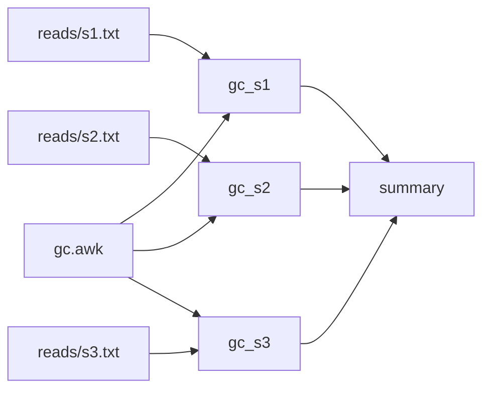

This page walks through a small workflow from an empty directory: write it, check it, run it, run it again, change one input, and see exactly which rules run and why. It takes a few minutes and needs only workz on your `PATH` ([Installation](Installation.md)).

A few words come up before [Concepts](Concepts.md) defines them properly: a **rule** is one command with the files it reads and writes; a **launch** is one execution of `workz run`, and an **attempt** is one try of a rule within it; a rule's **key** records what it ran with, so an unchanged rule is **reused** instead of run again.

## The workflow

The example computes the GC content of three samples of reads, one rule per sample, and a fourth rule that gathers the three results into a table.



Create the inputs in an empty directory:

```sh
mkdir gc-content && cd gc-content
mkdir reads
printf 'ACGTGGCCAT\nGGCCGGTTAA\nCCGGATATGC\n' > reads/s1.txt
printf 'ATATATGCAT\nTTAAGCATAT\nAATTCCGATA\n' > reads/s2.txt
printf 'GGGCCCGCGC\nCGCGATGCCG\nGCGCGGCCAA\n' > reads/s3.txt
```

The rules share a small awk script, `gc.awk`:

```awk
# Prints the fraction of G and C bases in the sequences read.
{ bases += length($0); gc += gsub(/[GC]/, "") }
END { printf "%.3f\n", gc / bases }
```

And `workflow.toml` declares the four rules:

```toml
[workflow]
name = "gc-content"

[defaults]
threads = 1
memory = "64M"

[[rules]]
name = "gc_s1"
input = ["gc.awk", "reads/s1.txt"]
output = ["gc/s1.txt"]
shell = "awk -f gc.awk reads/s1.txt > gc/s1.txt"

[[rules]]
name = "gc_s2"
input = ["gc.awk", "reads/s2.txt"]
output = ["gc/s2.txt"]
shell = "awk -f gc.awk reads/s2.txt > gc/s2.txt"

[[rules]]
name = "gc_s3"
input = ["gc.awk", "reads/s3.txt"]
output = ["gc/s3.txt"]
shell = "awk -f gc.awk reads/s3.txt > gc/s3.txt"

[[rules]]
name = "summary"
input = ["gc/s1.txt", "gc/s2.txt", "gc/s3.txt"]
output = ["summary.tsv"]
shell = "for s in s1 s2 s3; do printf '%s\\t%s\\n' $s $(cat gc/$s.txt); done > summary.tsv"
```

A few things to notice:

- Every rule names its inputs and outputs explicitly. workz links `summary` to the three `gc_` rules because their outputs are its inputs; there are no wildcards to expand.
- `gc.awk` is an input of each `gc_` rule, so editing the script runs them again.
- `[defaults]` gives every rule one thread and 64 MiB of memory. The memory request is a hard limit while the rule runs.
- The commands write into `gc/` without creating it: workz makes the directory of every output before an attempt starts.

## Check it

```sh
workz validate workflow.toml
```

```text
valid: gc-content (4 rules, 4 selected, 0 groups, 0 shared)
```

`validate` checks the file, every key in it, and the graph. A misspelled key is an error that points at its line and suggests the key you meant ([Troubleshooting](Troubleshooting.md#workflow-errors)).

`graph` shows what feeds what, here as text; it also writes DOT and JSON, and draws the shared inputs and groups of larger workflows ([Writing workflows](Writing-Workflows.md#check-before-running)):

```sh
workz graph --format text workflow.toml
```

```text
gc_s1  1 thread, 64 MiB
  before summary (gc/s1.txt)
gc_s2  1 thread, 64 MiB
  before summary (gc/s2.txt)
gc_s3  1 thread, 64 MiB
  before summary (gc/s3.txt)
summary  1 thread, 64 MiB
  after gc_s1 (gc/s1.txt), gc_s2 (gc/s2.txt), gc_s3 (gc/s3.txt)
```

`plan` says what a run would do, and why:

```sh
workz plan workflow.toml
```

```text
run   gc_s1  (no completed record)
run   gc_s2  (no completed record)
run   gc_s3  (no completed record)
run   summary  (producer gc_s1 runs)
4 to run, 0 to reuse
```

## Run it

```sh
workz run workflow.toml --max-threads 2 --max-memory 1G
```

```text
[0/4] budget 2 threads, 1.0 GiB, 2 jobs
[0/4] page .workz/launches/20261027T224948.994-d496b983/report.html, drawn again every 5 s while the launch runs
[0/4] started gc_s1 (attempt 1)
[0/4] started gc_s2 (attempt 1)
[1/4] completed gc_s1 (3 ms)
[1/4] started gc_s3 (attempt 1)
[2/4] completed gc_s2 (4 ms)
[3/4] completed gc_s3 (3 ms)
[3/4] started summary (attempt 1)
[4/4] completed summary (4 ms)
{"engine":"workz 0.6.0 sha256:...","engine_key":4,"launch":"20261027T224948.994-d496b983","status":"completed","counts":{"completed":4,...}
```

The first line gives the budget the launch may use. Without `--max-threads` and `--max-memory` it takes every CPU and three quarters of the memory, so on a shared machine set both. The second line names the launch's page, which a browser can keep open to follow the launch ([Reports](Reports.md#the-html-report)). The budget of two threads lets two of the one-thread rules run at once; `gc_s3` starts when one of them finishes, and `summary` when all three have. Progress goes to standard error and the launch summary to standard output as one line of JSON (shortened here).

```sh
cat summary.tsv
```

```text
s1	0.600
s2	0.233
s3	0.867
```

## Run it again

Nothing changed, so nothing needs to run:

```sh
workz plan workflow.toml
```

```text
reuse gc_s1  (unchanged)
reuse gc_s2  (unchanged)
reuse gc_s3  (unchanged)
reuse summary  (unchanged)
0 to run, 4 to reuse
```

`workz run workflow.toml --max-threads 2 --max-memory 1G` prints its budget, its page and its summary, with `"reused":4`, and runs nothing. A rule is reused when every part of its [key](Reuse-and-Resume.md#the-rule-key) is the same as when it last completed and its outputs are still the files it wrote.

## Change one input

Append a read to the second sample and ask again:

```sh
printf 'GGGGCCCCAT\n' >> reads/s2.txt
workz plan workflow.toml
```

```text
reuse gc_s1  (unchanged)
run   gc_s2  (inputs changed)
reuse gc_s3  (unchanged)
run   summary  (producer gc_s2 runs)
2 to run, 2 to reuse
```

`explain` shows every part of a rule's key against its record (paths shortened):

```sh
workz explain workflow.toml gc_s2
```

```text
rule gc_s2: runs (inputs changed)
  recorded: 2026-10-27T22:49:49.006Z, attempt .../gc-content/.workz/launches/20261027T224948.994-d496b983/attempts/gc_s2/001
  command    same
  environment same
  request    same
  writes     same
  inputs     changed
  producers  same
  engine key same
  input changed: .../gc-content/reads/s2.txt
    was 26697629:33:1793141388966199637:1793141388966199637
    now 26697629:44:1793141389057291996:1793141389057291996
```

The `was` and `now` lines are the file's [identity](Reuse-and-Resume.md#file-identity): inode, size, and modification and change times. workz notices a change without reading the file. Run again, and only the two rules run:

```sh
workz run workflow.toml --max-threads 2 --max-memory 1G
```

```text
[0/4] budget 2 threads, 1.0 GiB, 2 jobs
[0/4] page .workz/launches/20261027T224949.073-f2ed00dc/report.html, drawn again every 5 s while the launch runs
[2/4] started gc_s2 (attempt 1)
[3/4] completed gc_s2 (3 ms)
[3/4] started summary (attempt 1)
[4/4] completed summary (5 ms)
```

## Look at what happened

Every launch leaves a record in `.workz/`, which grows with each one and holds every attempt's output and the values of `--pass-env` variables: add `.workz/` to the project's `.gitignore`. `status --history` lists the launches, newest first:

```sh
workz status --history
```

```text
LAUNCH                          STATUS         ELAPSED  DONE  FAILED  CANCELLED
20261027T224949.073-f2ed00dc    completed        21 ms     4       0          0
20261027T224949.047-acd754d6    completed         9 ms     4       0          0
20261027T224948.994-d496b983    completed        23 ms     4       0          0
```

`workz report` prints one row per attempt of the newest launch, with wall and CPU time, memory request and peak, and how long the rule waited; `workz report --bottlenecks` says what limited the launch. On a workflow that runs for minutes, `workz watch` in a second terminal shows the launch live. [Watching a launch](Watching-a-Launch.md) and [Reports](Reports.md) show both on a larger workflow.

## Where next

- Read [Concepts](Concepts.md) for the vocabulary the rest of the guide uses.
- One rule per sample, as here, is what a [pipeline template](Writing-Workflows.md#prepare-from-a-template) writes for you: `workz init --template` starts one, and `workz prepare` turns it into `workflow.toml`.
- Learn to [write larger workflows](Writing-Workflows.md) and to [choose requests](Resources-and-Scheduling.md).
- Keep the [workflow reference](Workflow-Reference.md) and the [command reference](Command-Reference.md) at hand.
