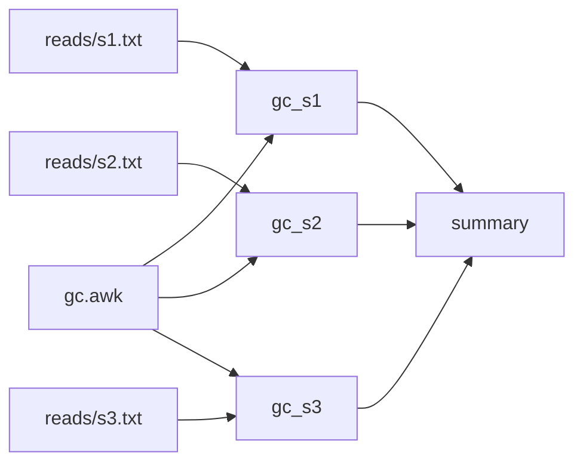

This page walks through a small workflow from an empty directory: write it, check it, run it, run it again, change one input, and see exactly which rules run and why. It takes a few minutes and needs only kanit on your `PATH` ([Installation](Installation.md)).

A few words come up before [Concepts](Concepts.md) defines them properly: a **rule** is one command with the files it reads and writes; a **launch** is one execution of `kanit run`, and an **attempt** is one try of a rule within it; a rule's **key** records what it ran with, so an unchanged rule is **reused** instead of run again.

## The workflow

The example computes the GC content of three samples of reads, one rule per sample, and a fourth rule that gathers the three results into a table.



Create the inputs in an empty directory:

```sh
mkdir gc-content && cd gc-content
mkdir reads
printf 'ACGTGGCCAT\nGGCCGGTTAA\nCCGGATATGC\n' > reads/s1.txt
printf 'ATATATGCAT\nTTAAGCATAT\nAATTCCGATA\n' > reads/s2.txt
printf 'GGGCCCGCGC\nCGCGATGCCG\nGCGCGGCCAA\n' > reads/s3.txt
```

The rules share a small awk script, `gc.awk`:

```awk
# Prints the fraction of G and C bases in the sequences read.
{ bases += length($0); gc += gsub(/[GC]/, "") }
END { printf "%.3f\n", gc / bases }
```

And `workflow.toml` declares the four rules:

```toml
[workflow]
name = "gc-content"

[defaults]
threads = 1
memory = "64M"

[[rules]]
name = "gc_s1"
input = ["gc.awk", "reads/s1.txt"]
output = ["gc/s1.txt"]
shell = "awk -f gc.awk reads/s1.txt > gc/s1.txt"

[[rules]]
name = "gc_s2"
input = ["gc.awk", "reads/s2.txt"]
output = ["gc/s2.txt"]
shell = "awk -f gc.awk reads/s2.txt > gc/s2.txt"

[[rules]]
name = "gc_s3"
input = ["gc.awk", "reads/s3.txt"]
output = ["gc/s3.txt"]
shell = "awk -f gc.awk reads/s3.txt > gc/s3.txt"

[[rules]]
name = "summary"
input = ["gc/s1.txt", "gc/s2.txt", "gc/s3.txt"]
output = ["summary.tsv"]
shell = "for s in s1 s2 s3; do printf '%s\\t%s\\n' $s $(cat gc/$s.txt); done > summary.tsv"
```

A few things to notice:

- Every rule names its inputs and outputs explicitly. kanit links `summary` to the three `gc_` rules because their outputs are its inputs; there are no wildcards to expand.
- `gc.awk` is an input of each `gc_` rule, so editing the script runs them again.
- `[defaults]` gives every rule one thread and 64 MiB of memory. The memory request is a hard limit while the rule runs.
- The commands write into `gc/` without creating it: kanit makes the directory of every output before an attempt starts.

## Check it

```sh
kanit validate workflow.toml
```

```text
valid: gc-content (4 rules, 4 selected, 0 groups, 0 shared)
```

`validate` checks the file, every key in it, and the graph. A misspelled key is an error that points at its line and suggests the key you meant ([Troubleshooting](Troubleshooting.md#workflow-errors)).

`graph` shows what feeds what, here as text; it also writes DOT and JSON, and draws the shared inputs and groups of larger workflows ([Writing workflows](Writing-Workflows.md#check-before-running)):

```sh
kanit graph --format text workflow.toml
```

```text
gc_s1  1 thread, 64 MiB
  before summary (gc/s1.txt)
gc_s2  1 thread, 64 MiB
  before summary (gc/s2.txt)
gc_s3  1 thread, 64 MiB
  before summary (gc/s3.txt)
summary  1 thread, 64 MiB
  after gc_s1 (gc/s1.txt), gc_s2 (gc/s2.txt), gc_s3 (gc/s3.txt)
```

`plan` says what a run would do, and why:

```sh
kanit plan workflow.toml
```

```text
STEP     RULES    RUN  REUSE  WHY
gc           3      3      0  no completed record
summary      1      1      0  producer gc_s1 runs
4 to run, 0 to reuse
```

`plan --rules` gives one row per rule instead, and `plan --json` every decision for a script.

## Run it

```sh
kanit run workflow.toml --max-threads 2 --max-memory 1G
```

```text
kanit 0.9.0   gc-content   launch 20261108T121724.311-8efeb4eb
          plan         4 rules: 2 steps
          budget       2 threads, 1.0 GiB, 2 jobs, isolated
          records      .workz/latest/   log launch.log   page report.html

          STEP     RULES
          gc           3
          summary      1

TIME      RULES  STATUS  STEP        TOOK             MEMORY      CPU  NOTE
05:17:24    0/4  START   gc_s1                   - /  64 MiB    - / 1
05:17:24    0/4  START   gc_s2                   - /  64 MiB    - / 1
05:17:24    1/4  DONE    gc_s1       4 ms        - /  64 MiB    - / 1
05:17:24    1/4  START   gc_s3                   - /  64 MiB    - / 1
05:17:24    2/4  DONE    gc_s2       5 ms        - /  64 MiB    - / 1
05:17:24    3/4  DONE    gc_s3       3 ms        - /  64 MiB    - / 1
05:17:24    3/4  START   summary                 - /  64 MiB    - / 1
05:17:24    4/4  DONE    summary     5 ms        - /  64 MiB    - / 1
          completed    4 of 4 rules done in 0.5 s
          steps        gc       ✓ 3 of 3 done                   slowest gc_s2 5 ms
                       summary  ✓ 1 of 1 done
          slowest      summary 5 ms   gc_s2 5 ms   gc_s1 4 ms
          records      .workz/latest/   log launch.log   page report.html
          next         kanit report --bottlenecks   what limited this launch
```

The launch opens with its shape: four rules in two steps, three of them in the step `gc` (kanit reads the step from the part of each name before its last `_`), and the budget the launch may use. Without `--max-threads` and `--max-memory` it takes every CPU and three quarters of the memory, so on a shared machine set both. `records` says where the launch keeps its records: `.workz/latest/` is the newest launch, with its text log `launch.log` and its page `report.html`, which a browser can keep open to follow the launch ([Reports](Reports.md#the-html-report)). Under the column header, each row has the time, how many of the four rules are done, what happened, the rule, how long it took, and its memory and CPU against its request; `-` is a figure the rule ended too soon to measure. The budget of two threads lets two of the one-thread rules run at once; `gc_s3` starts when one of them finishes, and `summary` when all three have. The log goes to standard error, and the summary to standard output: what was done, each step's progress, the slowest rules, where the records are and what to look at next. `--json` prints the summary as JSON instead, for a script. On a terminal the `START` rows give way to a footer of the step's progress and the running rules.

```sh
cat summary.tsv
```

```text
s1	0.600
s2	0.233
s3	0.867
```

## Run it again

Nothing changed, so nothing needs to run:

```sh
kanit plan workflow.toml
```

```text
STEP     RULES    RUN  REUSE  WHY
gc           3      0      3  unchanged
summary      1      0      1  unchanged
0 to run, 4 to reuse
```

`kanit run workflow.toml --max-threads 2 --max-memory 1G` runs nothing, and its summary says `4 of 4 rules done in 0.5 s: 4 reused`. A rule is reused when every part of its [key](Reuse-and-Resume.md#the-rule-key) is the same as when it last completed and its outputs are still the files it wrote.

## Change one input

Append a read to the second sample and ask again:

```sh
printf 'GGGGCCCCAT\n' >> reads/s2.txt
kanit plan workflow.toml --rules
```

```text
RULE     DECISION  WHY
gc_s1    reuse     unchanged
gc_s2    run       inputs changed
gc_s3    reuse     unchanged
summary  run       producer gc_s2 runs
2 to run, 2 to reuse
```

`explain` shows every part of a rule's key against its record (paths shortened):

```sh
kanit explain workflow.toml gc_s2
```

```text
rule gc_s2: runs (inputs changed)
  recorded: 2026-11-07T06:08:53.343Z, attempt .../20261107T060853.332-05be5410/attempts/gc_s2/001
  command    same
  environment same
  request    same
  writes     same
  inputs     changed
  producers  same
  engine key same
  input changed: .../gc-content/reads/s2.txt
    was 46503978:33:1794031733304681825:1794031733304681825
    now 46503978:44:1794031733387039562:1794031733387039562
```

The `was` and `now` lines are the file's [identity](Reuse-and-Resume.md#file-identity): inode, size, and modification and change times. kanit notices a change without reading the file. Run again, and only the two rules run:

```sh
kanit run workflow.toml --max-threads 2 --max-memory 1G
```

```text
kanit 0.9.0   gc-content   launch 20261108T121725.412-bce6cb75
          plan         4 rules: 2 steps
          budget       2 threads, 1.0 GiB, 2 jobs, isolated
          records      .workz/latest/   log launch.log   page report.html

          STEP     RULES
          gc           3
          summary      1

TIME      RULES  STATUS  STEP        TOOK             MEMORY      CPU  NOTE
05:17:25    2/4  START   gc_s2                   - /  64 MiB    - / 1
05:17:25    3/4  DONE    gc_s2       4 ms        - /  64 MiB    - / 1
05:17:25    3/4  START   summary                 - /  64 MiB    - / 1
05:17:25    4/4  DONE    summary     6 ms        - /  64 MiB    - / 1
```

## Look at what happened

Every launch leaves a record in `.workz/`, which grows with each one and holds every attempt's output and the values of `--pass-env` variables: add `.workz/` to the project's `.gitignore`. `status --history` lists the launches, newest first:

```sh
kanit status --history
```

```text
LAUNCH                         STATUS         ELAPSED  COMPLETED  REUSED  FAILED  BLOCKED  CANCELLED
20261108T121725.412-bce6cb75   completed        0.5 s          2       2       0        0          0
20261108T121724.876-2f5ea3db   completed        0.5 s          0       4       0        0          0
20261108T121724.311-8efeb4eb   completed        0.5 s          4       0       0        0          0
```

`kanit report` prints one row per attempt of the newest launch, with wall and CPU time, memory request and peak, and how long the rule waited; `kanit report --bottlenecks` says what limited the launch. On a workflow that runs for minutes, `kanit watch` in a second terminal shows the launch live. [Watching a launch](Watching-a-Launch.md) and [Reports](Reports.md) show both on a larger workflow.

## Where next

- Read [Concepts](Concepts.md) for the vocabulary the rest of the guide uses.
- One rule per sample, as here, is what a [pipeline template](Writing-Workflows.md#prepare-from-a-template) writes for you: `kanit init --template` starts one, and `kanit prepare` turns it into `workflow.toml`.
- Learn to [write larger workflows](Writing-Workflows.md) and to [choose requests](Resources-and-Scheduling.md).
- Keep the [workflow reference](Workflow-Reference.md) and the [command reference](Command-Reference.md) at hand.
