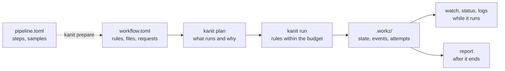

kanit runs a prepared graph of file-producing rules on one Linux workstation. You describe each rule's input files, output files, shell command and resource request in a TOML file; kanit runs every rule whose inputs are ready, as many at once as the machine's CPU and memory budget allows, and keeps a complete record of every attempt.

It runs pipelines expanded into concrete steps, one rule per sample and step, hundreds or thousands of them: `kanit prepare` writes them from a pipeline template, or a program of your own does. kanit does not match wildcards at run time, install tools or talk to a cluster. It is one executable, with no daemon and no database: it schedules, isolates, reuses and records, and it shows you what limited the run.

`kanit plan` reads the workflow and the records of earlier launches and says which rules would run and why. `kanit run` starts the rules that need to run inside one systemd scope for the launch, each in a cgroup that enforces its request. Everything kanit learns goes into `.workz/` in the working directory, which `watch`, `status`, `logs` and `report` read during the launch and after it.

## Read in this order

1. **[Installation](Installation.md)**: what kanit needs from the system, and how to build it.
2. **[Getting started](Getting-Started.md)**: a four-rule workflow, run, reused and run again after an edit.
3. **[Concepts](Concepts.md)**: rules, launches, attempts, budgets and rule keys, the words every other page uses.
4. **Write workflows**
   - [Writing workflows](Writing-Workflows.md): structure a workflow, write it from a template or a program, check it, and choose requests.
   - [Resources and scheduling](Resources-and-Scheduling.md): the budget, resource groups, shared inputs and the order rules start in.
   - [Reuse and resume](Reuse-and-Resume.md): when a rule is reused, when it runs again, and how to force it.
   - [Containers and services](Containers-and-Services.md): rules in local images, and a large index held once for many rules.
5. **Run and observe**
   - [Running workflows](Running-Workflows.md): isolation, failures, retries, and steering a running launch.
   - [Watching a launch](Watching-a-Launch.md): the live terminal view, `status` and `logs`.
   - [Reports](Reports.md): what each attempt used, what limited the launch, how two launches compare, and what produced the results.
6. **Reference**
   - [Workflow reference](Workflow-Reference.md): every table and key, with types, defaults and limits.
   - [Command reference](Command-Reference.md): every command and option, and the exit statuses.
   - [Records](Records.md): the files under `.workz/` and the event stream.
   - [Troubleshooting](Troubleshooting.md): common errors and what to do about them.

