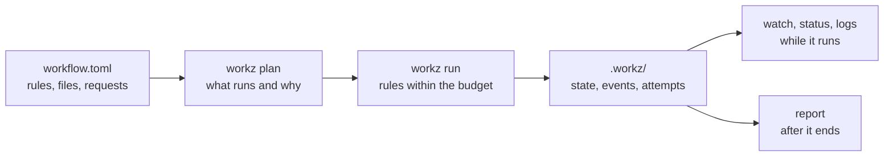

workz runs a prepared graph of file-producing rules on one Linux workstation. You describe each rule's input files, output files, shell command and resource request in a TOML file; workz runs every rule whose inputs are ready, as many at once as the machine's CPU and memory budget allows, and keeps a complete record of every attempt.

It is built for pipelines that someone, or some program, has already expanded into concrete steps: one rule per sample and step, hundreds or thousands of them. workz does not expand wildcards, install tools or talk to a cluster. It schedules, isolates, reuses and records, and it shows you what limited the run.

`workz plan` reads the workflow and the records of earlier launches and says which rules would run and why. `workz run` starts the rules that need to run inside one systemd scope for the launch, each in a cgroup that enforces its request. Everything workz learns goes into `.workz/` in the working directory, which `watch`, `status`, `logs` and `report` read during the launch and after it.

## Read in this order

1. **[Installation](Installation.md)**: what workz needs from the system, and how to build it.
2. **[Getting started](Getting-Started.md)**: a four-rule workflow, run, reused and run again after an edit.
3. **[Concepts](Concepts.md)**: rules, launches, attempts, budgets and rule keys, the words every other page uses.
4. **Write workflows**
   - [Writing workflows](Writing-Workflows.md): structure a workflow, generate it from a script, and choose requests.
   - [Resources and scheduling](Resources-and-Scheduling.md): the budget, resource groups, shared inputs and the order rules start in.
   - [Reuse and resume](Reuse-and-Resume.md): when a rule is reused, when it runs again, and how to force it.
   - [Containers and services](Containers-and-Services.md): rules in local images, and a large index held once for many rules.
5. **Run and observe**
   - [Running workflows](Running-Workflows.md): isolation, failures, retries, and steering a running launch.
   - [Watching a launch](Watching-a-Launch.md): the live terminal view, `status` and `logs`.
   - [Reports](Reports.md): what each attempt used, what limited the launch, and how two launches compare.
6. **Reference**
   - [Workflow reference](Workflow-Reference.md): every table and key, with types, defaults and limits.
   - [Command reference](Command-Reference.md): every command and option, and the exit statuses.
   - [Records](Records.md): the files under `.workz/` and the event stream.
   - [Troubleshooting](Troubleshooting.md): common errors and what to do about them.

## At a glance

- One executable written in Zig, with no daemon and no database. The engine itself uses a few MiB of memory.
- Linux x86-64 with cgroup v2 and a systemd user manager; rootless Podman for container rules.
- A rule runs again only when a part of its key changed (its command, environment, request, declared outputs, inputs, producers or the engine key), or when you ask with `--rerun-rule`; a changed output is never silently overwritten.
- Each task's memory request is a hard limit enforced by its cgroup, and its CPU, memory and I/O use is recorded.
- This guide describes workz 0.3.0. Before 1.0, a minor version may change the workflow format, the records and the command line; the changelog in the repository lists every change.
