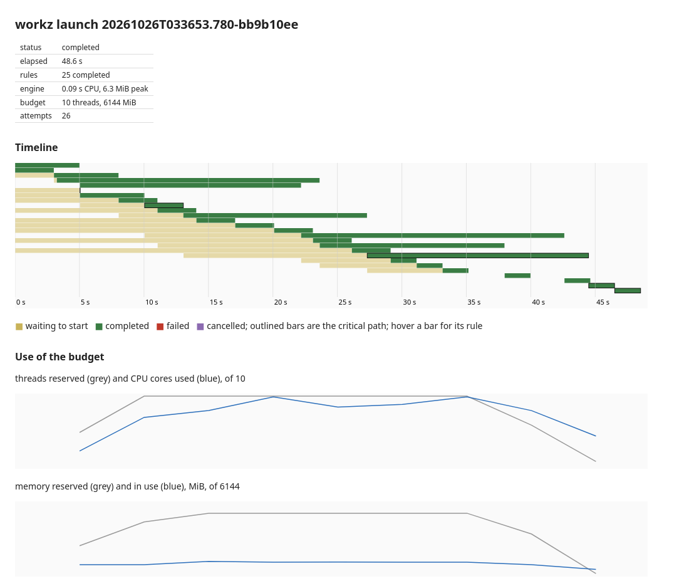

`workz report` turns a launch's records into answers: what each attempt used, what limited the launch, what each step should request, and how two launches differ. Every report reads `.workz/` only, so you can run it during a launch, after it, or on a launch from last week. The examples on this page come from one demo launch: six samples through qc, trim, align and count, then a report, 25 rules on a budget of 10 threads and 6 GiB, with a 600 MiB shared index. Every rule declares its step, sample, category and tool ([Concepts](Concepts.md#steps-samples-categories-and-tools)).

## What each attempt used

`workz report` prints one row per attempt of the newest launch, or of `--launch ID`, as TSV:

```text
rule	attempt	status	wall_s	cpu_s	cpu_efficiency	threads	memory_mib	peak_mib	max_rss_mib	peak_per_request	oom_kills	limit_events	waited_s	wait_reason	cpu_stall	memory_stall	io_stall	delegated	reason	step	sample	category	tool
align_S1	1	completed	16.946	47.184	0.93	3	1500	402.9	403.4	0.27	0	0	0.000	-	0.001	0.000	0.000	false	-	align	S1	alignment	bowtie2
align_S2	1	completed	19.913	56.028	0.94	3	1500	402.7	403.6	0.27	0	0	0.167	loading shared inputs	0.000	0.000	0.000	false	-	align	S2	alignment	bowtie2
trim_S4	1	failed	0.008	0.002	0.14	2	512	1.1	3.7	0.00	0	0	5.012	group:disk	0.001	0.000	0.000	false	exited with status 1	trim	S4	trimming	fastp
trim_S4	2	completed	3.004	2.992	0.50	2	512	1.7	3.9	0.00	0	0	5.006	threads	0.000	0.000	0.000	false	-	trim	S4	trimming	fastp
```

| Column             | Unit    | Meaning                                    |
| ------------------ | ------- | ------------------------------------------ |
| `wall_s`, `cpu_s`  | seconds | elapsed and CPU time of the attempt        |
| `cpu_efficiency`   | ratio   | CPU time over wall time times threads      |
| `threads`          | threads | request                                    |
| `memory_mib`       | MiB     | request                                    |
| `peak_mib`         | MiB     | cgroup peak, page cache included           |
| `max_rss_mib`      | MiB     | largest resident set of one process        |
| `peak_per_request` | ratio   | `peak_mib` over `memory_mib`               |
| `oom_kills`        | count   | out-of-memory kills in the cgroup          |
| `limit_events`     | count   | times the cgroup reached its limit         |
| `waited_s`         | seconds | ready but not started                      |
| `wait_reason`      | text    | what it waited for longest                 |
| `cpu_stall`        | ratio   | share of wall time stalled on CPU          |
| `memory_stall`     | ratio   | share of wall time stalled on memory       |
| `io_stall`         | ratio   | share of wall time stalled on I/O          |
| `delegated`        | boolean | work most likely ran outside workz         |
| `reason`           | text    | why the attempt failed, or `-`             |
| `step`, `sample`   | text    | the rule's step and sample, or `-`         |
| `category`, `tool` | text    | the rule's category and tool, or `-`       |

- Stalls come from the kernel's pressure counters for the attempt's cgroup: the share of time some of its processes waited for CPU, memory or I/O.
- For launches run with `--no-isolation`, `peak_mib`, `peak_per_request` and the stall columns are `NA`, and `oom_kills` and `limit_events` are 0.
- `--format json` prints the same attempts as a JSON array, with times unrounded and a few more fields, such as the attempt directory.

## What limited the launch

`workz report --bottlenecks` reads the same records and the event stream and explains where the time went:

```text
launch 20261026T193258.808-5428517c: 48.0 s elapsed, 26 attempts, 157.6 task-seconds

critical path (last task back to the start)
  at     10.0 s  trim_S4                                      ran      3.0 s, waited   10.0 s
  at     27.0 s  align_S4                                     ran     16.9 s, waited   14.0 s
  at     44.0 s  count_S4                                     ran      2.0 s, waited    0.0 s
  at     46.0 s  report                                       ran      2.0 s, waited    0.0 s
  4 rules: 23.9 s running, 24.0 s waiting for resources

waiting for resources (ready but not started)
  threads                              143.7 s
  group:disk                            58.2 s
  loading shared inputs                  0.2 s

resource groups (while their rules waited)
  disk                                58.2 s waited; in 100% of the samples a waiting rule fitted the free threads and memory: a higher max would have started it earlier

requests per step (completed attempts)
  STEP                             N   WALL S   MEM REQ  MAX RSS   PEAK  SUGGEST  THREADS  CPU EFF  CHARACTER
  align                            6    101.5     1500M     404M    403M     512M        3     0.93  CPU-bound; requests 988M more than its peak needs
  count                            6     12.0      256M       4M      2M      64M        1     0.99  CPU-bound
  qc                               6     18.0      256M       4M      2M      64M        1     0.99  CPU-bound
  report                           1      2.0      256M       4M      2M      64M        1     1.00  CPU-bound
  trim                             6     24.0      512M       4M      2M      64M        2     0.50  mixed; requests 448M more than its peak needs; uses about 1.0 of 2 threads

time per category (completed attempts)
  CATEGORY                       STEPS  ATTEMPTS     WALL S      CPU S  CPU SHARE
  alignment                          1         6      101.5      282.8      83.5%
  trimming                           1         6       24.0       23.9       7.1%
  qc                                 1         6       18.0       17.9       5.3%
  quantification                     1         6       12.0       11.9       3.5%
  report                             1         1        2.0        2.0       0.6%

time per tool (completed attempts)
  TOOL                           STEPS  ATTEMPTS     WALL S      CPU S  CPU SHARE
  bowtie2                            1         6      101.5      282.8      83.5%
  fastp                              1         6       24.0       23.9       7.1%
  fastqc                             1         6       18.0       17.9       5.3%
  featureCounts                      1         6       12.0       11.9       3.5%
  multiqc                            1         1        2.0        2.0       0.6%

samples (completed attempts), most CPU time first
  SAMPLE                         STEPS  ATTEMPTS     WALL S      CPU S  SLOWEST STEP
  S5                                 4         4       29.9       66.1  align 19.9 s
  S2                                 4         4       27.9       64.0  align 19.9 s
  S1                                 4         4       27.0       57.1  align 16.9 s
  S4                                 4         4       24.9       55.2  align 16.9 s
  S3                                 4         4       24.0       48.1  align 14.0 s
  S6                                 4         4       21.9       46.0  align 13.9 s

shared inputs
  NAME                           KIND     STARTS   LOAD S   MEMORY     PEAK  SUGGEST
  genome                         mapped        1      0.2     600M     602M        -

utilization (run samples every 5 s)
  threads reserved 8.0 of 10 on average; CPU in use 7.5 cores
  memory reserved 4208 of 6144 MiB on average; run cgroup peaked at 1220 MiB
```

Read it from the top:

- **Critical path.** The chain of rules that ended last, traced back to the start. Here it spent as long waiting for resources (24.0 s) as running (23.9 s), so the launch was limited by the budget, not by the length of its longest chain. When a critical path waits little, only faster rules or a shorter chain make the launch shorter.
- **Waiting for resources.** The total time ready rules waited, by reason. Threads dominate: more threads would shorten this launch if the machine has them.
- **Resource groups.** For each group that held rules back, the share of run samples in which a rule waiting for the group would have fitted the free threads and memory, counted per waiting rule. From 25%, the report says a larger `max` would have started them earlier; below that, it says the budget was full and a larger group would not help much. Here it was 100%: the group alone held them back.
- **Requests per step.** For each [step](Concepts.md#steps-samples-categories-and-tools): attempts, total wall time, memory request, largest process RSS and cgroup peak, suggested request, thread request, mean CPU efficiency, and a character. Notes after the character flag out-of-memory kills, requests far above the peak, a step that reached its limit through page cache without being killed, and a step that uses under half the threads it reserves.
- **Time per category and per tool.** The steps, attempts, wall time and CPU time of each category and each tool, most CPU time first, with its share of all CPU time. Here alignment took 83.5% of it: a faster aligner would save the most.
- **Samples.** Each sample's steps, attempts, wall time and CPU time, most CPU time first, and the step it spent longest in. When that step took at least 1.5 times its median and 2 s more, the line says how many times the median: that sample is the one to look at. Here S5 and S2 aligned for 19.9 s against 16.9 s, which is not enough to be marked.
- **Shared inputs.** Each shared input's starts, load time, declared memory and peak. Services get a suggested `memory`.
- **Utilization.** The average threads and memory reserved, the CPU cores in use, and the run cgroup's peak, from the samples taken every 5 s while rules run.

The character names what a step spent its time on, judged from its stall shares and CPU efficiency: `memory-throttled` (stalled on memory at least 20% of the time), `I/O-bound` (on I/O at least 30%), `CPU-starved` (waiting for CPU at least 30%, usually more threads than its quota), `CPU-bound` (CPU efficiency at least 0.7), `mostly waiting` (efficiency under 0.3), or `mixed`. Without stall data, in launches run with `--no-isolation`, it is `CPU-bound` at efficiency 0.7 or more and `-` otherwise.

An attempt that completed after at least half a second while using under a tenth of its CPU request, and less memory than a twentieth of its request or 64 MiB, whichever is larger, is counted as **delegated**: its command most likely handed the work to another supervisor, such as a systemd service or a container runtime outside workz. Its counters do not describe the work. A note counts the delegated attempts, and when most attempts of a step are delegated, the report gives no sizing advice for that step.

## Request sizing

`workz report --suggest` prints the suggested request for each step, for a workflow generator to apply:

```text
step	attempts	threads	threads_used	suggest_threads	memory_mib	peak_mib	suggest_mib	delegated
align	6	3	2.82	3	1500	403	512	false
count	6	1	1.00	1	256	4	64	false
qc	6	1	1.00	1	256	4	64	false
report	1	1	1.00	1	256	4	64	false
trim	6	2	1.00	1	512	4	64	false
```

- `peak_mib` is the largest memory any completed attempt of the step used: its process RSS, or its cgroup peak for rules that use shared inputs or containers, where the RSS misses the work.
- `suggest_mib` is that peak plus 20%, rounded up to a multiple of 64 MiB, and at least 64 MiB.
- `threads_used` is the largest CPU time over wall time of any completed attempt. `suggest_threads` rounds it up, ignoring a surplus under 0.05, and never exceeds the current request.
- `--format json` prints the same as a JSON array.

Here `trim` reserves 2 threads and 512 MiB but used 1 thread and 4 MiB, and `align` reserves 1500 MiB for a 403 MiB peak. Applying the suggestions lets more rules run at once on the same budget. Suggestions come from what the measured inputs needed; size for the largest input you expect, not the smallest you measured.

## Comparing launches

`workz report --compare OTHER` compares the newest launch, or `--launch ID`, with another one, named by launch ID, by launch directory, or by a working directory for its newest launch. Here the demo ran again with `--rerun` on 14 threads instead of 10 (paths shortened):

```text
baseline .../.workz/launches/20261026T193258.808-5428517c
launch   .../.workz/launches/20261026T193346.830-862c8523

                          BASELINE     LAUNCH   CHANGE
  elapsed s                   48.0       44.0     -8%
  attempts                      26         25
  reserved thread-s            385        385      0%

per step (completed attempts)
  STEP                             N   WALL S (MEDIAN)          PEAK MiB (MAX)           CPU S (TOTAL)
  align                            6    16.93   16.98      0%      403     405      0%    282.8   281.3     -1%
  count                            6     2.00    2.00      0%        2       2      0%     11.9    12.0      1%
  qc                               6     3.00    3.00      0%        2       2      0%     17.9    18.0      1%
  report                           1     2.00    2.01      0%        2       2      0%      2.0     2.0      0%
  trim                             6     4.00    4.01      0%        2       2      0%     23.9    23.9      0%
```

Four more threads saved 8% of the elapsed time, while every step ran as before, so the gain came from scheduling alone. The bottleneck report of the second launch shows the next limits: waiting for `group:disk` grew from 58 to 96 s, and ready rules now also waited 57 s for memory.

Steps whose work ran outside workz in either launch are marked, and their memory and CPU comparisons do not describe the work. A step with no completed attempt on one side, for example one reused in the newer launch, shows `-` for that side and says where it did not run.

## The HTML report

`workz report --format html > report.html` writes the launch as one self-contained page, with no scripts and nothing loaded from elsewhere, to open in a browser or attach to a message. It follows the reader's light or dark color scheme and prints cleanly.



The page holds, in order:

1. The launch's name, status, ID and start time, and any launch error.
2. Cards for the elapsed time, the rules done, the attempts and retries, the CPU cores in use against the threads reserved, the peak memory in use, and the engine's own cost.
3. A timeline with one labelled row per attempt: the wait for resources as a thin bar, then the run in the color of its result, with the critical path outlined. Hovering a bar gives its times.
4. Charts of threads reserved against CPU cores in use, and memory reserved against memory in use, over the launch, with the budget as a dashed line.
5. What limited the launch: the critical path step by step, the rule-seconds that ready rules waited for each resource, and the full bottleneck report folded below them.
6. For each step, the threads and memory requested against what its attempts used, with the suggested requests.
7. Every failed or cancelled attempt with the last 40 lines of its standard error.
8. The attempt table, which scrolls under a fixed header.
