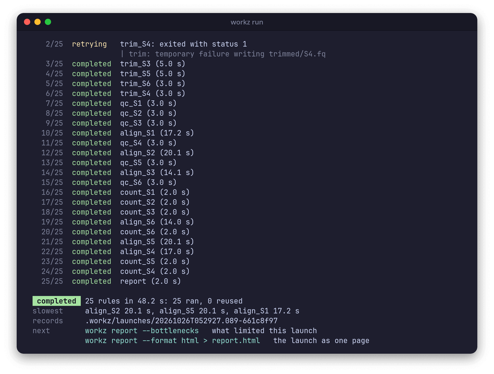
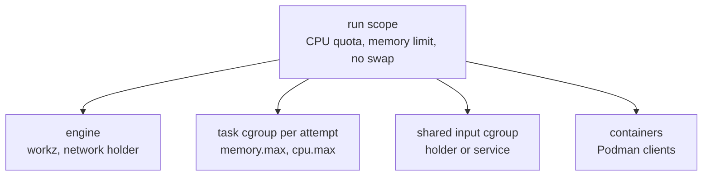

This page covers `workz run`: what each command sees, how a launch is isolated from the rest of the machine, what happens when rules fail, and how to stop or retry rules while a launch runs. The [command reference](Command-Reference.md#run) lists every option.

## Starting a launch

```sh
workz run workflow.toml --max-threads 16 --max-memory 60G
```

- `--max-threads`, `--max-memory` and `--jobs` set the [budget](Resources-and-Scheduling.md#the-budget).
- `--target RULE` (repeatable) runs only that rule and the rules it depends on.
- `--keep-going` keeps running independent rules after a failure ([Failures](#failures)).
- `--retry N` and `--timeout DURATION` apply to rules that set no `retries` or `timeout` of their own.
- `--quiet` drops the progress lines; failures still print.

On a terminal, `run` prints a line for each rule that completes, retries, fails or is blocked, and keeps one status line below them: a bar of the rules done, running, failed and waiting, the counts, the elapsed time and the names of the running rules. A failure's line is followed by the last lines of the attempt's standard error. When the launch ends, a short summary follows on standard output:



Off a terminal, such as in a script or a log file, each start, completion and failure is one plain line on standard error, prefixed with the count of finished rules, and the summary is one line of JSON on standard output, the same content as the launch's `summary.json` ([Records](Records.md#summaryjson)). `--json` prints the JSON summary on a terminal too, and `--no-color` or `NO_COLOR=1` turns colors off.

Only one launch runs in a working directory at a time; a second one stops at once with `another run holds .../.workz/lock`. Other commands, such as `watch`, `status` and `report`, read the records and work while it runs.

## What a command sees

A host rule's command is written to `command.sh` in its attempt directory and run with `bash -euo pipefail`, so an unset variable or a failing command anywhere in a pipeline fails the attempt.

- **Directory.** It starts in the rule's `workdir`, or in the working directory.
- **Streams.** Standard input is `/dev/null`. Standard output and error go to `stdout.log` and `stderr.log` in the attempt directory.
- **Environment.** Only `PATH`, `HOME`, `USER`, `LOGNAME`, `LANG`, `LC_ALL`, `TZ`, `TMPDIR`, `XDG_RUNTIME_DIR`, `DBUS_SESSION_BUS_ADDRESS` and `TERM` pass from your shell, with the names given with `--pass-env NAME`. Everything else, credentials included, stays out. workz adds `WORKZ_RULE` (the rule name), `WORKZ_ATTEMPT_DIR` (the attempt directory), `WORKZ_THREADS` and `WORKZ_MEMORY_MIB` (the request).
- **Network.** Only loopback. Rules of one launch share a network namespace, so they can reach each other on `127.0.0.1`, but nothing outside the machine.

`PATH`, `LANG`, `LC_ALL`, `TZ` and the `--pass-env` names are part of every rule key, so changing them reruns rules ([Reuse and resume](Reuse-and-Resume.md#the-rule-key)). Container rules see a different set ([Containers and services](Containers-and-Services.md#what-the-container-sees)).

## Isolation

`workz run` starts itself again inside a transient systemd user scope (`systemd-run --user --scope`), limited to the thread budget as a CPU quota and to the memory budget plus 256 MiB, with no swap. Inside the scope, every attempt and every shared input gets a cgroup of its own:



- Each attempt runs in its own process group and its own cgroup. Ending an attempt, for a timeout, a failure elsewhere or an interrupt, ends every process in it, including processes that left the process group.
- Shell rules run in one user and network namespace created for the run, with only loopback.
- `--slice NAME.slice` places the run's scope inside a systemd slice of yours, so its limits sit within the slice's.

If the engine itself is killed, by `kill -9`, the out-of-memory killer or a closed session, the process that holds the run's network namespace notices that the engine's end of its pipe closed and kills the run's cgroup. Every task, container and service of the launch ends with the engine, so a new launch never races with leftovers of the old one.

### Without isolation

`--no-isolation` runs without the scope, the cgroups and the network namespace, for machines without a systemd user manager or cgroup v2:

- Requests still reserve the budget, so admission and scheduling are the same.
- Nothing enforces requests: there is no memory limit, no out-of-memory kill of the whole attempt, no CPU quota, and no cgroup counters in the records.
- Rules share the machine's network.
- If the engine is killed, a guard process kills the process groups of the tasks that were running.

## Failures

An attempt fails when its command exits with a non-zero status, is killed, runs out of memory, runs past its timeout, or exits 0 without writing a declared output. With `--keep-going`, four such failures look like this on a terminal:

```text
    1/5  failed     exits: exited with status 1
                    | sort: cannot read: samples.tsv: No such file or directory
    2/5  failed     no_output: exited 0 without output d.txt
    3/5  blocked    after: it needs a rule that did not complete
    4/5  failed     too_big: out of memory: could not stay within its 64 MiB request
    5/5  failed     slow: timed out after 2 s

 failed    after 2.0 s: 0 completed, 0 reused, 4 failed, 1 blocked
 failures  exits      exited with status 1
                      | sort: cannot read: samples.tsv: No such file or directory
           no_output  exited 0 without output d.txt
           slow       timed out after 2 s
           too_big    out of memory: could not stay within its 64 MiB request
 records   .workz/launches/20261026T052452.447-796d3243
 next      workz logs exits   the output of the failed attempt
           run the same command again: rules that completed are reused
```

The fifth rule, `after`, depends on `exits`, so it is blocked: it never starts, and the launch ends as `failed` with exit status 1. Off a terminal, each failure line ends with the path of the attempt's standard error instead, such as `(see .../attempts/exits/001/stderr.log)`.

- **Retries.** A failed attempt runs again while the rule has retries left (`retries` on the rule, or `--retry`), as a new attempt with its own directory. A rule that fails its last attempt has failed.
- **Without `--keep-going`**, the first failed rule stops the launch: running attempts are stopped, and rules that had not started are left `not_started`.
- **With `--keep-going`**, independent rules go on; only the rules that depend on a failed one are blocked.
- **Stopping an attempt** sends its process group `SIGTERM`, waits the grace period (`--grace`, default 10 s), then kills everything left in its cgroup. Container rules get 10 s more for Podman.

A failed rule has no completed record, so the next launch runs it again; everything that completed is reused.

[Troubleshooting](Troubleshooting.md#rules-that-fail) lists every failure reason and what to do about it.

## Interrupts

`Ctrl-C` (or `SIGTERM`, or `SIGHUP`) stops the launch gracefully: running attempts get `SIGTERM` and the grace period, and no new rule starts. A second interrupt, at least a second after the first, kills them at once. The launch ends with status `interrupted` and exit status 130; rules that had not started are `cancelled`.

## Steering a running launch

`workz control` sends a command to the newest launch of the working directory, which applies it at once:

```sh
workz control stop align_s3     # cancel this rule; its dependents are blocked, the rest goes on
workz control retry align_s3    # run a failed or cancelled rule again, with its blocked dependents
workz control cancel            # stop the launch, like an interrupt
```

Each command prints `sent: ...`, and the launch reports what it did on its standard error, for example `control stop align_s3: stopping`, even with `--quiet`. `retry` allows one more attempt whatever the rule's `retries`. A `cancel` ends the launch with exit status 130, unless the launch was already stopping after a failure; then it answers `already stopping`, and the status stays 1. The same commands are on the keys <kbd>S</kbd>, <kbd>R</kbd> and <kbd>X</kbd> of the [interactive view](Watching-a-Launch.md).

Commands go through the `control` file in the launch directory, which the engine watches; every one is recorded as a `control` event.

## Exit statuses

`workz run` exits with:

- `0` when no rule failed, was blocked or was left unstarted, and the launch was not interrupted. A rule stopped with `workz control stop` that nothing depends on is counted as `cancelled` and leaves the status at 0.
- `1` when a rule failed or was blocked, or when changed outputs, an input that does not match its manifest, or another running launch refused the launch.
- `2` when the command line or the workflow is invalid, or when the launch was refused before starting for another reason, such as a request larger than the budget, a missing input or a missing image.
- `130` when it was interrupted, or cancelled with `workz control cancel`.

Refusals that stop a launch before any rule runs are listed in [Troubleshooting](Troubleshooting.md#refused-launches); each leaves a launch directory and a summary with status `refused`. Two errors stop even earlier and leave no launch directory: another launch holding the lock, and a missing `systemd-run`.
