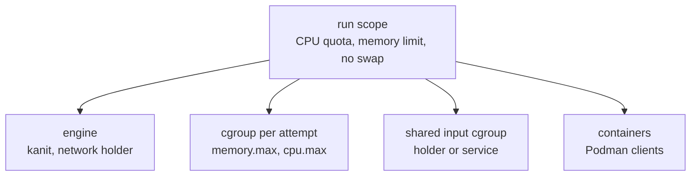

This page covers `kanit run`: what each command sees, how a launch is isolated from the rest of the machine, what happens when rules fail, and how to stop or retry rules while a launch runs. The [command reference](Command-Reference.md#run) lists every option.

## Starting a launch

```sh
kanit run workflow.toml --max-threads 16 --max-memory 60G
```

- `--max-threads`, `--max-memory` and `--jobs` set the [budget](Resources-and-Scheduling.md#the-budget).
- `--target RULE` (repeatable) runs only that rule and the rules it depends on.
- `--keep-going` keeps running independent rules after a failure ([Failures](#failures)).
- `--retry N` and `--timeout DURATION` apply to rules that set no `retries` or `timeout` of their own.
- `--threads STEP=N` gives a step's rules another thread count for this launch only ([Trying another thread count](Resources-and-Scheduling.md#trying-another-thread-count)).
- `--quiet` leaves out the header and the rows of rules that run well; failures, warnings and control commands still print, under the column header. `--verbose` keeps the `START` row of every rule on a terminal too.

Before a long launch, `kanit plan --budget` checks that every rule fits the budget ([Check before running](Writing-Workflows.md#check-before-running)).

`run` writes a row for every event of the launch, on standard error and in the launch's `launch.log`; a terminal leaves out the `START` rows and keeps a footer of the steps below the rows. Off a terminal:

```text
kanit 0.8.0   rnaseq-mini   launch 20261108T121740.229-ab51811a
          plan         7 rules: 4 steps for 2 samples
          budget       4 threads, 4.0 GiB, 4 jobs, isolated
          records      .workz/latest/   log launch.log   page report.html

          TOOL   VERSION  STEP    RULES
          fastp  1.4.0    trim        2
          star   2.7.11b  align       2
          awk    5.3.2    count       2
          sort   9.10     matrix      1

TIME      RULES  STATUS  TOOL   STEP    SAMPLE     TOOK               MEMORY      CPU  NOTE
05:17:40    0/7  START   fastp  trim    S2                      - /  2.4 GiB    - / 1
05:17:44    1/7  DONE    fastp  trim    S2        3.7 s   1.0 GiB /  2.4 GiB  1.0 / 1
05:17:44    1/7  START   fastp  trim    S1                      - /  2.4 GiB    - / 1  waited 3.8 s
05:17:44    1/7  START   star   align   S2                      - /  512 MiB    - / 2
05:17:45    2/7  DONE    star   align   S2        0.5 s   261 MiB /  512 MiB  0.7 / 2
05:17:45    2/7  START   awk    count   S2                      - /  256 MiB    - / 1
05:17:45    3/7  DONE    awk    count   S2        12 ms         - /  256 MiB    - / 1
05:17:48    4/7  DONE    fastp  trim    S1        3.9 s   1.0 GiB /  2.4 GiB  0.9 / 1
05:17:48    4/7  START   star   align   S1                      - /  512 MiB    - / 2
05:17:49    5/7  DONE    star   align   S1        0.5 s   261 MiB /  512 MiB  0.7 / 2
05:17:49    5/7  START   awk    count   S1                      - /  256 MiB    - / 1
05:17:49    6/7  DONE    awk    count   S1        13 ms         - /  256 MiB    - / 1
05:17:49    6/7  START   sort   matrix                          - /  256 MiB    - / 1
05:17:49    7/7  DONE    sort   matrix             2 ms         - /  256 MiB    - / 1
```

On a terminal, the `START` rows are left out and a footer of the steps stays below the rows; the same launch 6 s in:

```text
TIME      RULES  STATUS  TOOL   STEP    SAMPLE     TOOK               MEMORY      CPU  NOTE
05:17:53    1/7  DONE    fastp  trim    S1        3.8 s   1.0 GiB /  2.4 GiB  0.9 / 1
05:17:54    2/7  DONE    star   align   S1        0.5 s   261 MiB /  512 MiB  0.7 / 2
05:17:54    3/7  DONE    awk    count   S1        13 ms         - /  256 MiB    - / 1

                         fastp  trim    ━━━━━━━━────────  1/2  1 running
                         star   align   ━━━━━━━━────────  1/2
                         awk    count   ━━━━━━━━────────  1/2
                         sort   matrix  ────────────────  0/1
                         3 of 7 rules   1 running   6.2 s   trim/S2 1.6 s
```

- The launch opens with its shape: how many rules, steps and samples it selected, the budget and where its records are. A table of the steps follows, with each step's tool, version and rule count. kanit runs the [version commands](Writing-Workflows.md#tool-versions) before the first rule and waits at most 5 s for them; a slower one shows `measuring` there and goes on beside the rules, and the summary names its version.
- After a column header, every line is a row of one table:
  - `TIME`, the local time.
  - `RULES`, how many selected rules are done, of all selected. A reused rule has no row; it counts as done from the moment kanit reuses it.
  - `STATUS`, what happened, as a tag (below).
  - `TOOL`, the rule's tool.
  - `STEP` and `SAMPLE`, the rule's name. A rule that has a sample is named by its step and sample, and `STEP/SAMPLE` (such as `align/S2`) names it in commands; a rule without one is named by its rule name.
  - `TOOK`, the time from the rule's start to its end.
  - `MEMORY`, the peak the rule used against its request, `-` when the rule ended before it was measured.
  - `CPU`, the cores it used on average against its threads.
  - `NOTE`, what happened, in a few words.
- The widths of the columns are set when the launch starts, from every selected rule, so the rows stay aligned to the end. A table without samples or tools leaves out those columns. Off a terminal, each column is as wide as its longest name. On a terminal too narrow for that, tools are cut to 16 columns, steps to 24 and samples to 20, with `…` (`~` outside a UTF-8 locale) where a name was cut; the header's step table keeps the whole names. A terminal too narrow for the figures leaves out `MEMORY` and `CPU`, a narrower one narrows the name columns further, and a line still longer than the window is cut with the same mark, so no line wraps. Wide characters, such as those of Chinese, Japanese and Korean names, count as two columns.

| Tag     | Status      | Meaning                 |
| ------- | ----------- | ----------------------- |
| `START` | `running`   | an attempt started      |
| `DONE`  | `completed` | the rule completed      |
| `RETRY` | `retrying`  | another attempt follows |
| `FAIL`  | `failed`    | its last attempt failed |
| `BLOCK` | `blocked`   | a rule it needs failed  |
| `STOP`  | `cancelled` | stopped before it ended |
| `INFO`  |             | a shared input, a command or the counts |
| `WARN`  |             | a problem that does not stop the launch |

- `kanit status`, `kanit watch`, `--json` and the records name a rule's statuses; the tags are for the log. The summary counts the rules done, reused, failed, blocked and stopped; `--json` and the records call stopped rules `cancelled`.
- A `START` row shows the rule's request, and its note says how long the rule waited for room or which attempt it is.
- A failure names its reason in its note (`exit 2`, `timed out at 2h 00m`, `out of memory`, `killed by SIGSEGV`), quotes the last lines of its standard error or kept diagnostics, and names the command that shows its whole output. Rules that a failure blocks are reported once for that failure.
- An `INFO` row names a shared input in `STEP` when it loads, is ready, restarts or fails, the rule a `kanit control` command was for, or an interrupt. A `WARN` row names the rule it concerns, if any.
- On a terminal, color marks the status tags, the `START` rows are left out, and a footer below the rows shows where the launch is: one row per step with its tool, a bar and how many of its rules are done, ✓ when all of them are, and how many failed, are running, blocked or stopped; then the counts of all the rules, the elapsed time and the running rules, the longest first. On a short terminal the steps that are done fold into one row. `-v` keeps the `START` rows. `--no-color` or `NO_COLOR=1` turns colors off; outside a UTF-8 locale the marks are ASCII.
- Off a terminal, the `START` rows are kept, and every five minutes an `INFO` row with the counts is followed by the footer's step table and the running rules.
- `launch.log` in the launch directory keeps every line, `START` rows included, whole and without color, so `tail -f .workz/latest/launch.log` follows a launch from anywhere. `.workz/latest` always points to the newest launch.

When the launch ends, a summary follows on standard output: the outcome and counts, a matrix of samples by steps or a list of steps, the failed rules with their reasons, the rules they blocked, the slowest rules, where the records are and what to type next. `kanit status` prints the same summary later ([status](Watching-a-Launch.md#status)), and `launch.log` keeps it at its end. The summary is text wherever standard output goes, with colors only on a terminal; `--json` prints one line of JSON instead, the same content as the launch's `summary.json` ([Records](Records.md#summaryjson)), for a script to read.

Every launch keeps a page of its own, `report.html` in its launch directory, which a browser can keep open to follow the launch ([The HTML report](Reports.md#the-html-report)).

Only one launch runs in a working directory at a time; a second one stops at once with `another launch is running in DIR; watch it with kanit watch, or run again after it ends`. Other commands, such as `watch`, `status` and `report`, read the records and work while it runs.

## What a command sees

A host rule's command is written to `command.sh` in its attempt directory and run with `bash -euo pipefail`, so an unset variable or a failing command anywhere in a pipeline fails the attempt.

- **Directory.** It starts in the rule's `workdir`, or in the working directory.
- **Streams.** Standard input is `/dev/null`. Standard output and error go to `stdout.log` and `stderr.log` in the attempt directory.
- **Environment.** Only `PATH`, `HOME`, `USER`, `LOGNAME`, `LANG`, `LC_ALL`, `TZ`, `TMPDIR`, `XDG_RUNTIME_DIR`, `DBUS_SESSION_BUS_ADDRESS` and `TERM` pass from your shell, with the names given with `--pass-env NAME`. Everything else, credentials included, stays out. kanit adds `WORKZ_RULE` (the rule name), `WORKZ_ATTEMPT_DIR` (the attempt directory), `WORKZ_THREADS` and `WORKZ_MEMORY_MIB` (the request).
- **Network.** Only loopback. Rules of one launch share a network namespace, so they can reach each other on `127.0.0.1`, but nothing outside the machine.

`PATH`, `LANG`, `LC_ALL`, `TZ` and the `--pass-env` names are part of every rule key, so changing them reruns rules ([Reuse and resume](Reuse-and-Resume.md#the-rule-key)). Their values are recorded in `.workz/state.json`, and `kanit explain` shows how they changed, so pass variables that change a result, not secrets such as tokens. Container rules see a different set ([Containers and services](Containers-and-Services.md#what-the-container-sees)).

## Isolation

`kanit run` starts itself again inside a transient systemd user scope (`systemd-run --user --scope`), limited to the thread budget as a CPU quota and to the memory budget plus 256 MiB, with no swap. Inside the scope, every attempt and every shared input gets a cgroup of its own:



- Each attempt runs in its own process group and its own cgroup. Ending an attempt, for a timeout, a failure elsewhere or an interrupt, ends every process in it, including processes that left the process group.
- Shell rules run in one user and network namespace created for the run, with only loopback.
- `--slice NAME.slice` places the run's scope inside a systemd slice of yours, so its limits sit within the slice's.

If the engine itself is killed, the process holding its network namespace detects the closed pipe and kills the run's cgroup. This depends on that holder still running and being able to write `cgroup.kill`; the engine warns if the holder ends early. Work handed to another supervisor is outside the attempt's cgroup and counters. Stale containers may remain when cleanup fails; the next container launch checks for them.

### Without isolation

`--no-isolation` runs without the scope, the cgroups and the network namespace, for machines without a systemd user manager or cgroup v2:

- Requests still reserve the budget, so admission and scheduling are the same.
- Nothing enforces requests: there is no memory limit, no out-of-memory kill of the whole attempt, no CPU quota, and no cgroup counters in the records.
- Host rules share the machine's network. Podman rules still use `--network=none`.
- If the engine is killed, a guard process kills the process groups of the attempts that were running.
- A process that leaves its attempt's process group, such as one started with `setsid`, outlives the attempt: without a cgroup, nothing finds it.

## Failures

An attempt fails when its command exits with a non-zero status, is killed, runs out of memory, runs past its timeout, or exits 0 without writing a declared output. With `--keep-going`, four such failures look like this on a terminal:

```text
kanit 0.8.0   failures   launch 20261108T121728.669-4d10cd11
          plan         5 rules
          budget       4 threads, 1.0 GiB, 4 jobs, isolated
          records      .workz/latest/   log launch.log   page report.html

TIME      RULES  STATUS  STEP          TOOK             MEMORY      CPU  NOTE
05:17:29    0/5  FAIL    exits         3 ms        - /  64 MiB    - / 1  exit 2
                         │ sort: cannot read: samples.tsv: No such file or directory
                         kanit logs exits   .workz/latest/attempts/exits/001/
05:17:29    0/5  FAIL    no_output     3 ms        - /  64 MiB    - / 1  exited 0 without output d.txt
05:17:29    0/5  BLOCK   after                                           after exits failed
05:17:29    0/5  FAIL    too_big      51 ms   64 MiB /  64 MiB    - / 1  out of memory
                         raise its memory, or see kanit report --suggest
05:17:31    0/5  FAIL    slow         2.0 s        - /  64 MiB  0.0 / 1  timed out at 2.0 s

          failed       0 of 5 rules done in 2.5 s: 4 failed, 1 blocked
          failed       exits      exited with status 2: sort: cannot read: samples.tsv: No such file or di...
                       no_output  exited 0 without output d.txt
                       too_big    out of memory: could not stay within its 64 MiB request
                       slow       timed out after 2 s
          blocked      after      after exits failed
          records      .workz/latest/   log launch.log   page report.html
          next         kanit logs exits   the output of the failed attempt
                       kanit run          run again
```

The rule `after` depends on `exits`, so it is blocked: it never starts, and the launch ends as `failed` with exit status 1. A failure whose standard error or kept [diagnostics](Writing-Workflows.md#diagnostics) has lines quotes the last three and names the `kanit logs` command that shows them whole, with the attempt's directory: under `.workz/latest/` on a terminal, and under the launch's own directory off a terminal and in `launch.log`, where the path must stay true after later launches.

- **Retries.** A failed attempt runs again while the rule has retries left (`retries` on the rule, or `--retry`), as a new attempt with its own directory. A rule that fails its last attempt has failed.
- **Without `--keep-going`**, the first failed rule stops the launch: running attempts are stopped, and rules that had not started are left `not_started`.
- **With `--keep-going`**, independent rules go on; only the rules that depend on a failed one are blocked.
- **Stopping an attempt** sends its process group `SIGTERM`, waits the grace period (`--grace`, default 10 s), then kills everything left in its cgroup. The attempt ends when every process it started has ended, so a tool that tidies up after `SIGTERM` keeps the grace period when the rule's shell exits first. Container rules get 10 s more for Podman.

A failed attempt never becomes a completed record. If the rule had an earlier successful result, kanit restores its outputs and retains that record. The next launch checks the restored result against the current key and outputs: it can reuse a matching result, while a rule without a matching completed result runs again.

[Troubleshooting](Troubleshooting.md#rules-that-fail) lists every failure reason and what to do about it.

## Interrupts

`Ctrl-C` (or `SIGTERM`, or `SIGHUP`) stops the launch gracefully: running attempts get `SIGTERM` and the grace period, and no new rule starts. A second interrupt, at least a second after the first, kills them at once. After `kanit control cancel`, which stops the launch the same way, the first interrupt keeps the grace period and the second kills. The launch ends with status `interrupted` and exit status 130; rules that had not started are `cancelled`.

## Steering a running launch

`kanit control` sends a command to the newest launch of the working directory, which processes it in its event loop:

```sh
kanit control stop align_s3     # cancel this rule; its dependents are blocked, the rest goes on
kanit control retry align_s3    # run a failed or cancelled rule again, with its blocked dependents
kanit control cancel            # stop the launch, like an interrupt
```

Each command prints `sent: ...`, and the launch reports what it did in an `INFO` row of its log, under the rule's name, for example `control stop: stopping`, or `control stop: stopped before it started` for a rule that had not started, even with `--quiet`. `retry` allows one more attempt whatever the rule's `retries`. A `cancel` ends the launch with exit status 130, unless the launch was already stopping after a failure; then it answers `already stopping`, and the status stays 1. The same commands are on the keys <kbd>S</kbd>, <kbd>R</kbd> and <kbd>X</kbd> of the [interactive view](Watching-a-Launch.md).

Commands go through the `control` file in the launch directory, which the engine watches; every one is recorded as a `control` event.

## Exit statuses

`kanit run` exits with:

- `0` when no rule failed, was blocked or was left unstarted, and the launch was not interrupted. A rule stopped with `kanit control stop` that nothing depends on is counted as `cancelled`, the launch's summary says `stopped`, and the exit status stays 0.
- `1` when a rule failed or was blocked, or when changed outputs, an input that does not match its manifest, or another running launch refused the launch.
- `2` when the command line or the workflow is invalid, or when the launch was refused before starting for another reason, such as a request larger than the budget, a missing input or a missing image.
- `130` when it was interrupted, or cancelled with `kanit control cancel`.

Refusals after the launch records are opened leave a launch directory and a summary with status `refused`; see [Troubleshooting](Troubleshooting.md#refused-launches). Earlier errors, such as an invalid command line or workflow, a missing `systemd-run`, or another launch holding the lock, leave no new launch directory.
