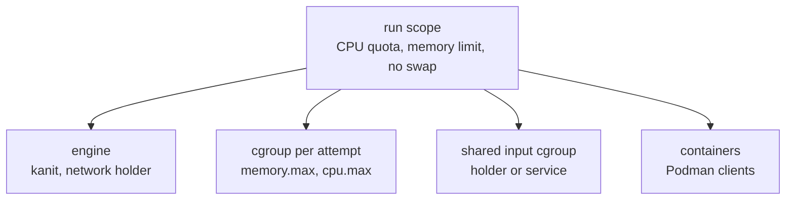

This page covers `kanit run`: what each command sees, how a launch is isolated from the rest of the machine, what happens when rules fail, and how to stop or retry rules while a launch runs. The [command reference](Command-Reference.md#run) lists every option.

## Starting a launch

```sh
kanit run workflow.toml --max-threads 16 --max-memory 60G
```

- `--max-threads`, `--max-memory` and `--jobs` set the [budget](Resources-and-Scheduling.md#the-budget).
- `--target RULE` (repeatable) runs only that rule and the rules it depends on.
- `--keep-going` keeps running independent rules after a failure ([Failures](#failures)).
- `--retry N` and `--timeout DURATION` apply to rules that set no `retries` or `timeout` of their own.
- `--threads STEP=N` gives a step's rules another thread count for this launch only ([Trying another thread count](Resources-and-Scheduling.md#trying-another-thread-count)).
- `--quiet` drops the progress lines; failures, warnings and control commands still print. `--verbose` keeps a line for every rule that starts.

Before a long launch, `kanit plan --budget` checks that every rule fits the budget ([Check before running](Writing-Workflows.md#check-before-running)).

`run` writes one line for every event of the launch, the same on a terminal, on standard error off a terminal and in the launch's `launch.log`:

```text
kanit 0.7.0   rnaseq-mini   launch 20261108T101855.266-41e7e452
          plan       7 rules in 4 steps for 2 samples
          budget     4 threads, 4.0 GiB, 4 jobs, isolated
          steps      trim 2   align 2   count 2   matrix 1
          tools      fastp   1.4.0     trim
                     star    2.7.11b   align
                     awk     5.3.2     count
                     sort    9.10      matrix
          records    .workz/latest/   log launch.log   page report.html
03:18:55  started    trim    S1  fastp   1 thread     2.4 GiB
03:18:56  tool       trim        fastp  1.4.0
03:18:59  completed  trim    S1  fastp   3.9 s   mem  1.0 GiB of  2.4 GiB   cpu  0.9 of 1
03:18:59  started    trim    S2  fastp   1 thread     2.4 GiB   waited 3.9 s
03:18:59  started    align   S1  star    2 threads    512 MiB
03:19:00  tool       align       star   2.7.11b
03:19:00  completed  align   S1  star    0.5 s   mem  277 MiB of  512 MiB   cpu  0.7 of 2
03:19:00  started    count   S1  awk     1 thread     256 MiB
03:19:00  tool       count       awk    5.3.2
03:19:00  completed  count   S1  awk     12 ms
03:19:00  sample             S1         all 3 steps completed   in 4.4 s
03:19:03  completed  trim    S2  fastp   4.0 s   mem  1.0 GiB of  2.4 GiB   cpu  0.9 of 1
03:19:03  step       trim        fastp  2 of 2 completed   in 7.9 s   slowest S2 4.0 s
03:19:03  started    align   S2  star    2 threads    512 MiB
03:19:04  completed  align   S2  star    0.5 s   mem  261 MiB of  512 MiB   cpu  0.8 of 2
03:19:04  step       align       star   2 of 2 completed   in 4.5 s   slowest S1 0.5 s
03:19:04  started    count   S2  awk     1 thread     256 MiB
03:19:04  completed  count   S2  awk     13 ms
03:19:04  step       count       awk    2 of 2 completed   in 4.0 s   slowest S2 13 ms
03:19:04  sample             S2         all 3 steps completed   in 4.5 s
03:19:04  started    matrix      sort    1 thread     256 MiB
03:19:04  completed  matrix      sort     3 ms
03:19:04  tool       matrix      sort   9.10
```

- The launch opens with its shape: how many rules, steps and samples it selected, the budget, each step with its rule count, each tool with the version an earlier launch recorded (`-` until one has) and the steps that use it, and where its records are.
- Every line has the local time, a status word, the rule's step and sample, its tool, and what happened, each in its own column; the times, memory and CPU of `started` and `completed` lines sit in fixed columns too. A rule that has a sample is named by its step and sample, and `STEP/SAMPLE` (such as `align/S2`) names it in commands; a rule without one is named by its rule name.
- The status words are `started`, `completed`, `retrying`, `failed`, `blocked` and `cancelled` for rules, `step` and `sample` when every selected rule of a step or sample has ended, `shared` for shared inputs and services, `tool` for what a tool's [version command](Writing-Workflows.md#tool-versions) printed in this launch, `control` for commands and interrupts, `warning`, and `progress`.
- A completed rule shows its time, its memory against its request when it was measured, and the cores it used against its threads. A failure names its reason in a few words (`exit 2`, `timed out at 2h 00m`, `out of memory at its 64 MiB`, `killed by SIGSEGV`), quotes the last lines of its standard error or kept diagnostics, and names the command that shows its whole output. Rules that a failure blocks are reported once for that failure.
- On a terminal, color marks the status words, the `started` lines are left out, and a footer below the lines shows a bar of the rules done, the counts, the elapsed time, every step's progress and the running rules. `-v` keeps the `started` lines. `--no-color` or `NO_COLOR=1` turns colors off; outside a UTF-8 locale the marks are ASCII.
- Off a terminal, the `started` lines are kept, and a `progress` line every five minutes carries the footer's counts.
- `launch.log` in the launch directory keeps every line, `started` included, whole and without color, so `tail -f .workz/latest/launch.log` follows a launch from anywhere. `.workz/latest` always points to the newest launch.

When the launch ends, a summary follows on standard output: the outcome and counts, a matrix of samples by steps or a list of steps, the failed rules with their reasons, the rules they blocked, the slowest rules, where the records are and what to type next. `kanit status` prints the same summary later ([status](Watching-a-Launch.md#status)), and `launch.log` keeps it at its end. The summary is text wherever standard output goes, with colors only on a terminal; `--json` prints one line of JSON instead, the same content as the launch's `summary.json` ([Records](Records.md#summaryjson)), for a script to read.

Every launch keeps a page of its own, `report.html` in its launch directory, which a browser can keep open to follow the launch ([The HTML report](Reports.md#the-html-report)).

Only one launch runs in a working directory at a time; a second one stops at once with `another launch is running in DIR; watch it with kanit watch, or run again after it ends`. Other commands, such as `watch`, `status` and `report`, read the records and work while it runs.

## What a command sees

A host rule's command is written to `command.sh` in its attempt directory and run with `bash -euo pipefail`, so an unset variable or a failing command anywhere in a pipeline fails the attempt.

- **Directory.** It starts in the rule's `workdir`, or in the working directory.
- **Streams.** Standard input is `/dev/null`. Standard output and error go to `stdout.log` and `stderr.log` in the attempt directory.
- **Environment.** Only `PATH`, `HOME`, `USER`, `LOGNAME`, `LANG`, `LC_ALL`, `TZ`, `TMPDIR`, `XDG_RUNTIME_DIR`, `DBUS_SESSION_BUS_ADDRESS` and `TERM` pass from your shell, with the names given with `--pass-env NAME`. Everything else, credentials included, stays out. kanit adds `WORKZ_RULE` (the rule name), `WORKZ_ATTEMPT_DIR` (the attempt directory), `WORKZ_THREADS` and `WORKZ_MEMORY_MIB` (the request).
- **Network.** Only loopback. Rules of one launch share a network namespace, so they can reach each other on `127.0.0.1`, but nothing outside the machine.

`PATH`, `LANG`, `LC_ALL`, `TZ` and the `--pass-env` names are part of every rule key, so changing them reruns rules ([Reuse and resume](Reuse-and-Resume.md#the-rule-key)). Their values are recorded in `.workz/state.json`, and `kanit explain` shows how they changed, so pass variables that change a result, not secrets such as tokens. Container rules see a different set ([Containers and services](Containers-and-Services.md#what-the-container-sees)).

## Isolation

`kanit run` starts itself again inside a transient systemd user scope (`systemd-run --user --scope`), limited to the thread budget as a CPU quota and to the memory budget plus 256 MiB, with no swap. Inside the scope, every attempt and every shared input gets a cgroup of its own:



- Each attempt runs in its own process group and its own cgroup. Ending an attempt, for a timeout, a failure elsewhere or an interrupt, ends every process in it, including processes that left the process group.
- Shell rules run in one user and network namespace created for the run, with only loopback.
- `--slice NAME.slice` places the run's scope inside a systemd slice of yours, so its limits sit within the slice's.

If the engine itself is killed, the process holding its network namespace detects the closed pipe and kills the run's cgroup. This depends on that holder still running and being able to write `cgroup.kill`; the engine warns if the holder ends early. Work handed to another supervisor is outside the attempt's cgroup and counters. Stale containers may remain when cleanup fails; the next container launch checks for them.

### Without isolation

`--no-isolation` runs without the scope, the cgroups and the network namespace, for machines without a systemd user manager or cgroup v2:

- Requests still reserve the budget, so admission and scheduling are the same.
- Nothing enforces requests: there is no memory limit, no out-of-memory kill of the whole attempt, no CPU quota, and no cgroup counters in the records.
- Host rules share the machine's network. Podman rules still use `--network=none`.
- If the engine is killed, a guard process kills the process groups of the attempts that were running.
- A process that leaves its attempt's process group, such as one started with `setsid`, outlives the attempt: without a cgroup, nothing finds it.

## Failures

An attempt fails when its command exits with a non-zero status, is killed, runs out of memory, runs past its timeout, or exits 0 without writing a declared output. With `--keep-going`, four such failures look like this on a terminal:

```text
kanit 0.7.0   failures   launch 20261108T101843.528-5cbfab09
          plan       5 rules
          budget     4 threads, 1.0 GiB, 4 jobs, isolated
          records    .workz/latest/   log launch.log   page report.html
03:18:43  failed     exits      exit 2 after 3 ms
                                │ sort: cannot read: samples.tsv: No such file or directory
                                kanit logs exits   .workz/latest/attempts/exits/001/
03:18:43  failed     no_output  exited 0 without output d.txt
03:18:44  blocked    after      after exits failed
03:18:44  failed     too_big    out of memory at its 64 MiB
                                raise its memory, or see kanit report --suggest
03:18:46  failed     slow       timed out at 2.0 s

          failed     0 of 5 rules done in 2.5 s: 4 failed, 1 blocked
          failed     exits      exited with status 2: sort: cannot read: samples.tsv: No such file or dire...
                     no_output  exited 0 without output d.txt
                     too_big    out of memory: could not stay within its 64 MiB request
                     slow       timed out after 2 s
          blocked    after      after exits failed
          records    .workz/latest/   log launch.log   page report.html
          next       kanit logs exits   the output of the failed attempt
                     kanit run          run again
```

The rule `after` depends on `exits`, so it is blocked: it never starts, and the launch ends as `failed` with exit status 1. A failure whose standard error or kept [diagnostics](Writing-Workflows.md#diagnostics) has lines quotes the last three and names the `kanit logs` command that shows them whole, with the attempt's directory: under `.workz/latest/` on a terminal, and under the launch's own directory off a terminal and in `launch.log`, where the path must stay true after later launches.

- **Retries.** A failed attempt runs again while the rule has retries left (`retries` on the rule, or `--retry`), as a new attempt with its own directory. A rule that fails its last attempt has failed.
- **Without `--keep-going`**, the first failed rule stops the launch: running attempts are stopped, and rules that had not started are left `not_started`.
- **With `--keep-going`**, independent rules go on; only the rules that depend on a failed one are blocked.
- **Stopping an attempt** sends its process group `SIGTERM`, waits the grace period (`--grace`, default 10 s), then kills everything left in its cgroup. The attempt ends when every process it started has ended, so a tool that tidies up after `SIGTERM` keeps the grace period when the rule's shell exits first. Container rules get 10 s more for Podman.

A failed attempt never becomes a completed record. If the rule had an earlier successful result, kanit restores its outputs and retains that record. The next launch checks the restored result against the current key and outputs: it can reuse a matching result, while a rule without a matching completed result runs again.

[Troubleshooting](Troubleshooting.md#rules-that-fail) lists every failure reason and what to do about it.

## Interrupts

`Ctrl-C` (or `SIGTERM`, or `SIGHUP`) stops the launch gracefully: running attempts get `SIGTERM` and the grace period, and no new rule starts. A second interrupt, at least a second after the first, kills them at once. After `kanit control cancel`, which stops the launch the same way, the first interrupt keeps the grace period and the second kills. The launch ends with status `interrupted` and exit status 130; rules that had not started are `cancelled`.

## Steering a running launch

`kanit control` sends a command to the newest launch of the working directory, which processes it in its event loop:

```sh
kanit control stop align_s3     # cancel this rule; its dependents are blocked, the rest goes on
kanit control retry align_s3    # run a failed or cancelled rule again, with its blocked dependents
kanit control cancel            # stop the launch, like an interrupt
```

Each command prints `sent: ...`, and the launch reports what it did in a `control` line of its log, for example `stop: stopping` for `align_s3`, or `stop: cancelled before it started` for a rule that had not started, even with `--quiet`. `retry` allows one more attempt whatever the rule's `retries`. A `cancel` ends the launch with exit status 130, unless the launch was already stopping after a failure; then it answers `already stopping`, and the status stays 1. The same commands are on the keys <kbd>S</kbd>, <kbd>R</kbd> and <kbd>X</kbd> of the [interactive view](Watching-a-Launch.md).

Commands go through the `control` file in the launch directory, which the engine watches; every one is recorded as a `control` event.

## Exit statuses

`kanit run` exits with:

- `0` when no rule failed, was blocked or was left unstarted, and the launch was not interrupted. A rule stopped with `kanit control stop` that nothing depends on is counted as `cancelled`, the launch's summary says `stopped`, and the exit status stays 0.
- `1` when a rule failed or was blocked, or when changed outputs, an input that does not match its manifest, or another running launch refused the launch.
- `2` when the command line or the workflow is invalid, or when the launch was refused before starting for another reason, such as a request larger than the budget, a missing input or a missing image.
- `130` when it was interrupted, or cancelled with `kanit control cancel`.

Refusals after the launch records are opened leave a launch directory and a summary with status `refused`; see [Troubleshooting](Troubleshooting.md#refused-launches). Earlier errors, such as an invalid command line or workflow, a missing `systemd-run`, or another launch holding the lock, leave no new launch directory.
