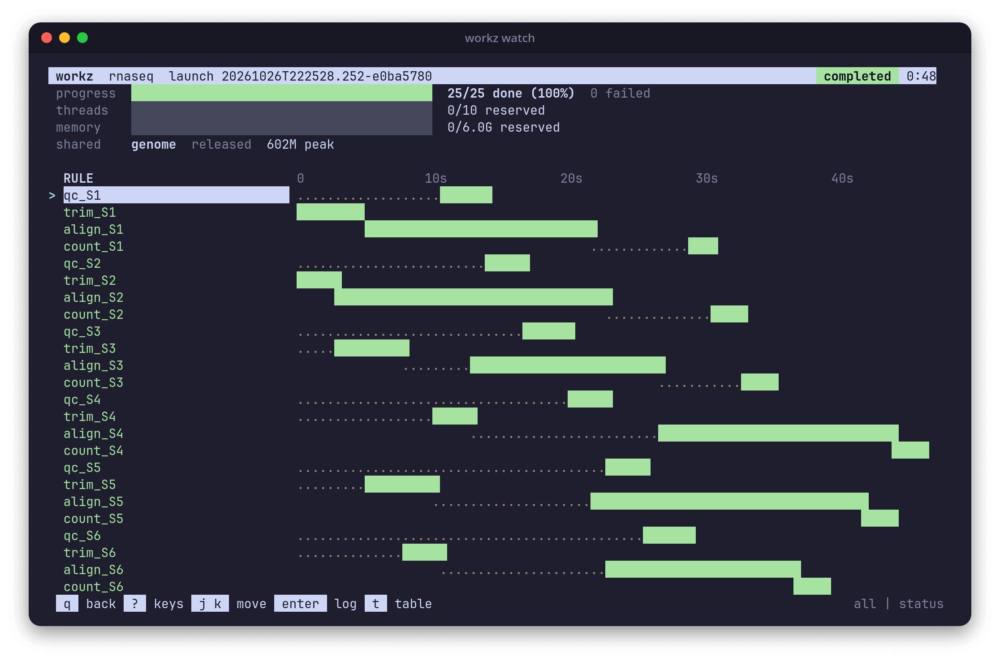

While a launch runs, and after it ends, three commands show it: `watch` for the live view, `status` for its summary, and `logs` for a rule's output. They read only the records in `.workz/`, so they work from any terminal and never slow the launch down.

## The live view

Run `workz watch` in the working directory, or `workz watch path/to/workflow.toml` from elsewhere, while `workz run` works in another terminal:


The header holds four gauges:

- **progress**: a bar of the selected rules, split into done, running, waiting and failed, with the count of each.
- **threads**: the threads reserved against the budget, and the CPU cores the run keeps busy.
- **memory**: the memory reserved against the budget, and the memory the run uses.
- **shared**: one line for each shared input, with its state and the memory it holds.

Below it is a table of every selected rule, running rules first, then waiting, failed, done and pending ones:

- **STATUS** and **RULE**: a long name is shortened in the middle, so `align_sample_0042_lane_3` keeps both of its ends.
- **ATT**: the attempt number.
- **TIME**: how long the rule has run, or how long it has waited to start.
- **CPU**: the cores the attempt uses against the threads it requested, such as `2.9/3`; for a finished rule, the average over its run.
- **MEMORY**: for a running rule, a bar and the memory its cgroup uses now against its request, such as `203M/1.5G`; the bar turns yellow from 70% of the request and red from 90%. For a finished rule, its recorded peak against its request.
- **LAST OUTPUT / REASON**: the last line the running attempt wrote to standard error, or to standard output if it wrote nothing to standard error; for other rules, why the rule waits or failed.

On a narrow terminal the memory bar goes first, then the CPU column, then the memory value. The selection stays on the top row until you move it, so the busiest rule stays selected as rules finish. The view stays open after the launch ends, so you can look through it; <kbd>q</kbd> leaves.

> [!TIP]
> Set `NO_COLOR=1`, or use a terminal with `TERM=dumb`, for a view without colors: bars are then drawn with characters, `#` for done and `>` for running.

### Keys

<kbd>?</kbd> shows every key in the view itself.

- <kbd>j</kbd> and <kbd>k</kbd>, or the up and down arrows, move the selection; <kbd>Space</kbd> and <kbd>b</kbd>, or <kbd>PgDn</kbd> and <kbd>PgUp</kbd>, move it a page; <kbd>g</kbd> and <kbd>G</kbd>, or <kbd>Home</kbd> and <kbd>End</kbd>, jump to the first and last rule.
- <kbd>Enter</kbd>, <kbd>l</kbd> or the right arrow follows the selected attempt's standard error as it grows, with lines that mention an error in red and a warning in yellow; <kbd>o</kbd> switches to standard output.
- <kbd>i</kbd> shows the selected rule in detail: its request, when it became ready and started, gauges of its CPU and memory against the request, how often it reached its memory limit, its stall times, and its last lines of output.
- <kbd>t</kbd> draws a timeline of the launch.
- <kbd>a</kbd> shows all rules, <kbd>r</kbd> running and retrying ones, <kbd>w</kbd> waiting and pending ones, <kbd>f</kbd> failed, blocked and cancelled ones, and <kbd>d</kbd> done ones.
- <kbd>/</kbd> searches rule names; <kbd>Enter</kbd> keeps the search and <kbd>Esc</kbd> clears it.
- <kbd>s</kbd> cycles the order: status, elapsed time, peak memory, name.
- <kbd>S</kbd> stops the selected rule and <kbd>R</kbd> retries it, as [`workz control`](Running-Workflows.md#steering-a-running-launch) does. <kbd>X</kbd> cancels the launch when pressed a second time within 3 s.
- <kbd>q</kbd> or <kbd>Esc</kbd> goes back, or leaves from the table; <kbd>h</kbd> or the left arrow goes back to the table; <kbd>Ctrl</kbd>+<kbd>C</kbd> leaves.

### Timeline

<kbd>t</kbd> draws every rule on one time axis, with ticks such as `30s`, `1m` and `1m30s`. A dotted stretch is the time a rule waited to start; then a bar shows its run, green when it completed, cyan while it runs, red where it failed and magenta where it was cancelled. Without colors the bar is drawn with `=`, `>`, `!` and `x`.



Here the align rules, with `priority = 10`, start as soon as their trim is done, while the qc rules wait for threads until the alignments finish. The critical path ran through `trim_S4`, `align_S4` and `count_S4` to `report`.

### Off a terminal

When its output is not a terminal, or with `--once`, `watch` prints a plain view of the running rules instead, again at every refresh until the launch ends:

```text
launch 20261026T221057.818-be24883d  running for 19.0 s
25 selected: 7 pending, 6 waiting, 4 running, 8 completed, 8 done
shared genome: ready

RUNNING                                      ATT   ELAPSED   MEM NOW  MEM PEAK  LAST OUTPUT
align_S2                                       1    15.9 s   203 MiB   402 MiB  Mapping reads: 3 threads
align_S4                                       1     5.9 s   204 MiB   403 MiB  Mapping reads: 3 threads
align_S5                                       1    14.0 s   203 MiB   402 MiB  Mapping reads: 3 threads
qc_S6                                          1     1.9 s   1.1 MiB   1.6 MiB  Started analysis of S6.fq
```

The second line counts the selected rules in each state; `done` adds the completed and reused ones. Failed rules follow under `FAILED`, each with its reason and the path of its standard error; once the launch has ended, the view drops the running table. `--interval MS` sets the refresh period (default 1000 ms, at least 100), and `--launch ID` shows an earlier launch instead of the newest. A launch whose engine was killed never records its end, so the repeating view does not stop by itself; `watch --once` and `status` show such a launch, and `status --history` marks it `running?`. Each refresh reads only the events added since the last one, so watching a launch of thousands of rules costs little.

## status

`workz status` prints the newest launch's summary once it has ended, or with `--launch ID` an earlier launch's. On a terminal it is the same short report `workz run` ends with: the outcome and counts, each failed rule with its reason and last line of error output, the launch's page, and the commands to look further:

```text
 failed    after 3.4 s: 2 completed, 0 reused, 1 failed, 1 blocked
 failures  align_S1  exited with status 3
                     | align: reference index is truncated
 page      .workz/launches/20261026T051434.360-95f2e7d0/report.html
 next      workz logs align_S1   the output of the failed attempt
           run the same command again: rules that completed are reused
```

A launch that completed lists its three slowest rules instead of failures. Off a terminal, or with `--json`, `status` prints the launch's [summary.json](Records.md#summaryjson) as written.

While the launch runs, `status` prints the plain view above once on a terminal. Off it, or with `--json`, it prints the summary's fields so far, with `"status": "running"`, so a script can poll one command whatever the launch's state:

```json
{"launch":"20261026T221057.818-be24883d","status":"running","counts":{"completed":8,"reused":0,"failed":0,"blocked":0,"cancelled":0,"running":4,"waiting":6,"pending":7},"selected":25,"elapsed_s":18.979420178,"launch_dir":"/home/me/rnaseq/.workz/launches/20261026T221057.818-be24883d"}
```

`workz status --history [N]` prints one line for each of the last N launches (default 10), newest first:

```text
LAUNCH                          STATUS         ELAPSED  DONE  FAILED  OTHER
20261026T221057.818-be24883d    completed       48.5 s    25       0      0
20261026T214107.045-dbca1c53    completed       48.2 s    25       0      0
20261026T212349.502-401d88e4    completed       45.1 s    25       0      0
```

`DONE` counts completed and reused rules, `FAILED` failed and blocked ones, and `OTHER` cancelled and unstarted ones. A launch that ended with an error shows it at the end of its line; one still running, or killed before it wrote its summary, shows `running?`.

## logs

`workz logs RULE` prints the standard output and error of the rule's newest attempt: in the newest launch that ran the rule, or else the attempt recorded for it. Here, the first attempt of a rule that failed once and then succeeded:

```sh
workz logs trim_S4 --attempt 1
```

```text
==> .../attempts/trim_S4/001/stdout.log <==
==> .../attempts/trim_S4/001/stderr.log <==
trim: temporary failure writing trimmed/S4.fq
```

- `--stderr` or `--stdout` prints one stream, without the headers.
- `--attempt N` picks attempt N in the newest launch that ran the rule, and `--launch ID` looks in that launch instead.
- `--follow` (`-f`) keeps printing a running attempt's output until it ends.

Every attempt's files stay in its attempt directory, `.workz/launches/<ID>/attempts/<rule>/<NNN>/`, until you remove the launch ([Records](Records.md)).
